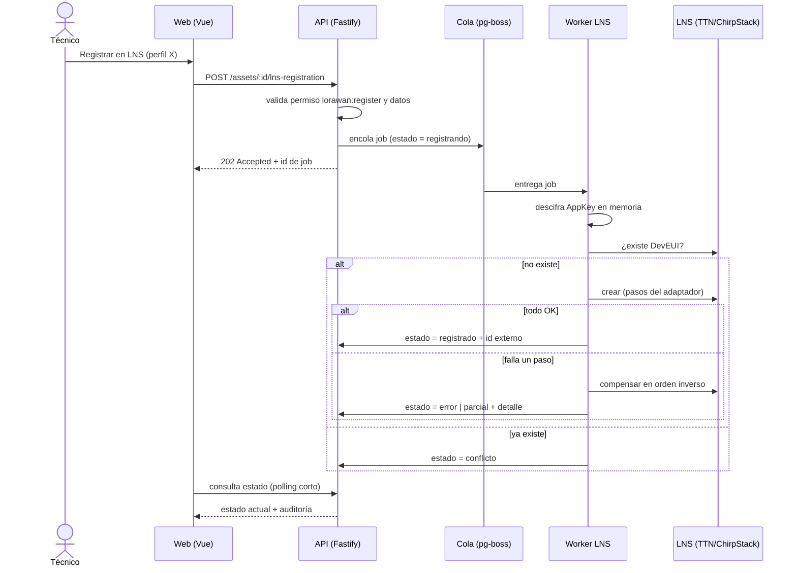
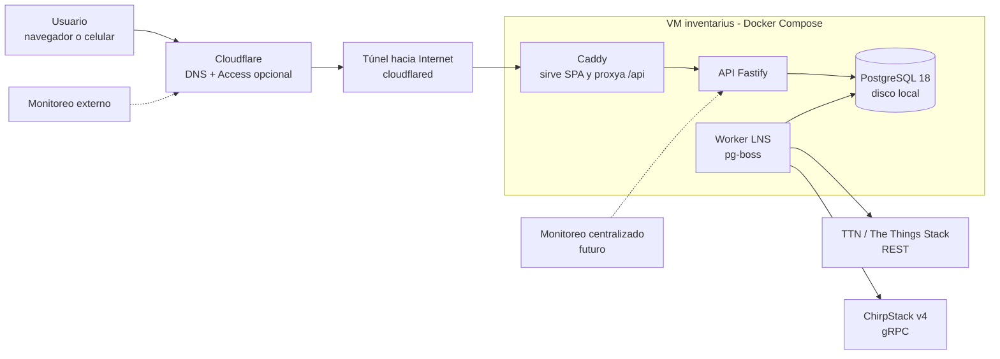
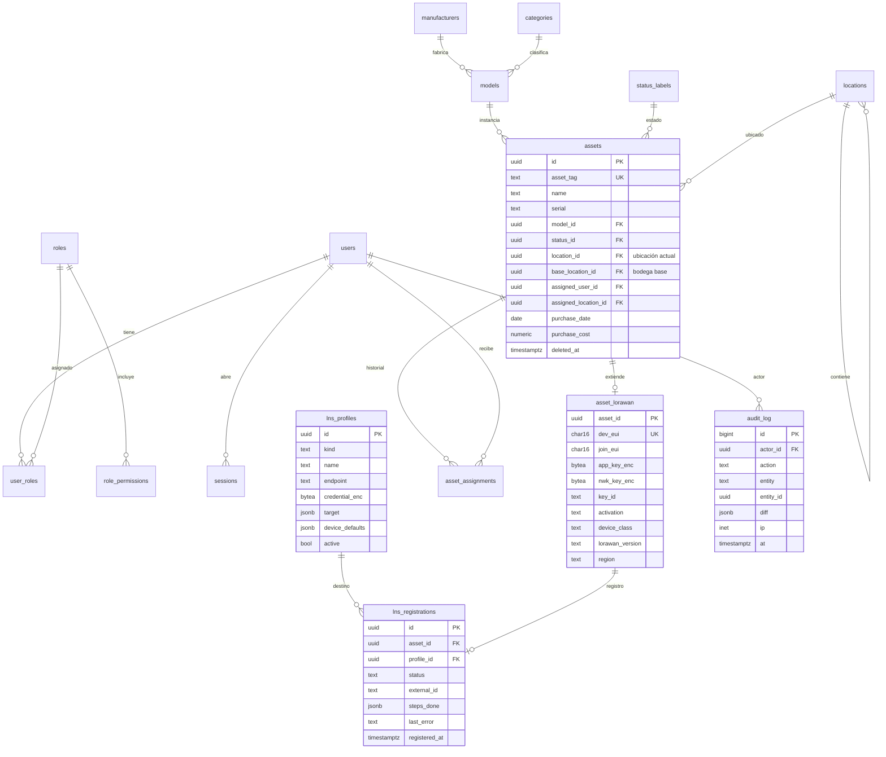
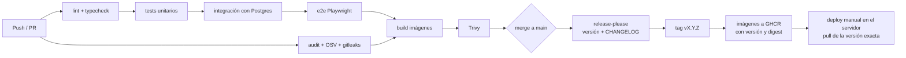

# Inventarius — Requerimiento y diseño MVP

Nov 16, 2026 · @Yatto · Estado: borrador v0.1

## 1. Resumen

**Inventarius** es una aplicación web de inventario de activos (estilo Snipe-IT), construida desde cero, simple y modular. Su diferencia: los activos de tipo **dispositivo LoRaWAN** se pueden registrar directamente en un Network Server (**ChirpStack v4** o **The Things Stack / TTN v3**) desde la ficha del activo, usando conexiones configuradas previamente como **perfiles LNS** dentro de la app.

Despliegue inicial: una VM de producción detrás de un túnel hacia Internet (ver sección 12). Requisito de diseño: debe poder migrarse sin cambios de código a otra infraestructura (por ejemplo, servidores del cliente), solo cambiando configuración.

### Objetivos del MVP

1. Registrar y consultar activos con su ciclo básico: alta, asignación (check-out / check-in), cambio de estado, baja e historial.
2. Usuarios con roles y permisos; todo cambio queda auditado.
3. Gestionar perfiles LNS (ChirpStack y TTN) y registrar / dar de baja un dispositivo LoRaWAN OTAA desde su ficha, con estado visible y reintento.
4. Interfaz responsiva y usable en celular en terreno, con buenas prácticas de UX/UI y accesibilidad.
5. Base técnica lista para crecer: versiones trabadas, migraciones versionadas, pruebas automáticas, CI, logs estructurados, métricas y health checks.

### Fuera de alcance del MVP

- Licencias de software, accesorios y componentes (módulos de Snipe-IT que vienen después). Los consumibles entran en la fase F3.5.
- Campos personalizados genéricos por categoría (el MVP solo trae la extensión LoRaWAN fija).
- Activación ABP, registro masivo, sincronización bidireccional con el LNS, lectura de uplinks o telemetría.
- Modo offline, app nativa, SSO/LDAP, API tokens para terceros, multiempresa.
- Adjuntos y fotos (se deja el modelo preparado).

Parte de esta lista entra después del MVP: ver la sección 16 (Requisitos v2), que manda sobre ella.

## 2. Lluvia de ideas priorizada

Todo lo que salió, clasificado con MoSCoW. **Must** = MVP. **Should** = entra si sobra tiempo en el MVP, si no es la primera iteración post-MVP. **Could / Won't (por ahora)** = backlog.

| Idea | Prioridad | Nota |
| --- | --- | --- |
| Activos, modelos, categorías, fabricantes, ubicaciones, estados | Must | Núcleo tipo Snipe-IT |
| Check-out / check-in a usuario o ubicación, historial por activo | Must |  |
| Usuarios, roles, permisos, auditoría | Must |  |
| Perfiles LNS ChirpStack y TTN con prueba de conexión | Must |  |
| Registro y baja OTAA de un dispositivo en el LNS | Must |  |
| Cifrado de AppKeys y API keys en reposo | Must |  |
| UI responsiva + vistas móviles, PWA instalable (sin offline) | Must |  |
| Health checks, métricas Prometheus, logs JSON | Must |  |
| Búsqueda y filtros en listados, paginación del lado servidor | Must |  |
| Etiqueta con QR por activo e impresión | Should | Clave para terreno |
| Escanear QR con la cámara para abrir la ficha | Should |  |
| Importación CSV de datos LoRaWAN por número de serie (DevEUI, JoinEUI, AppKey) | Must (F3) | Lotes de medidores: se dan de alta en lote (RF-27) y los datos LoRaWAN se completan por CSV (RF-66) |
| 2FA TOTP para usuarios administradores | Should |  |
| Registro masivo en LNS desde un lote importado | Could |  |
| Verificación de estado contra el LNS (último visto, joined) | Could |  |
| Campos personalizados por categoría | Could | Base para otros tipos de dispositivo |
| Adjuntos y fotos (instalación, factura) | Could |  |
| Mantenimientos y garantías con alertas | Could |  |
| API tokens con alcance para integraciones (n8n, GLPI) | Could |  |
| Dashboard de resumen | Could |  |
| Consumibles por cantidad (EPP, etc.): ingreso a bodega, entrega, stock y mínimo | Must (F3.5) | Fase propia después de F3 (RF-70 a RF-74) |
| Modo offline en terreno | Won't por ahora | Complejidad alta (sincronización, conflictos) |
| SSO (OIDC), LDAP | Won't por ahora | Se deja la capa de auth desacoplada |
| Otros LNS (Loriot, Actility, Helium) | Won't por ahora | Entran como nuevos adaptadores |

## 3. Roles y permisos (RBAC)

Modelo: **permisos atómicos** (`recurso:acción`) agrupados en **roles**. Un usuario tiene uno o más roles. El backend valida permisos en cada endpoint; el frontend solo oculta lo que el usuario no puede hacer (nunca es la barrera de seguridad).

El MVP trae cuatro roles semilla. Un administrador puede crear roles nuevos y editar la matriz de permisos de los roles no protegidos. El rol Administrador no se puede borrar ni quedarse sin al menos un usuario activo.

| Permiso | Administrador | Operador | Técnico de campo | Lector |
| --- | --- | --- | --- | --- |
| `asset:read` | Sí | Sí | Sí | Sí |
| `asset:write` (crear, editar, cambiar estado) | Sí | Sí | No | No |
| `asset:checkout` (asignar / devolver) | Sí | Sí | Sí | No |
| `asset:delete` (baja lógica) | Sí | Sí | No | No |
| `catalog:write` (modelos, categorías, fabricantes, ubicaciones, estados) | Sí | Sí | No | No |
| `lorawan:read` | Sí | Sí | Sí | Sí |
| `lorawan:register` (registrar / dar de baja en LNS) | Sí | Sí | Sí | No |
| `lorawan:keys:reveal` (ver AppKey en claro) | Sí | No | No | No |
| `lns_profile:manage` | Sí | No | No | No |
| `user:manage`, `role:manage` | Sí | No | No | No |
| `audit:read` | Sí | Sí | No | No |

Reglas:

- Revelar una AppKey o una API key exige permiso explícito, se registra en auditoría y la clave se muestra enmascarada por defecto.
- El Técnico de campo puede registrar en el LNS pero no ver claves: el backend las usa sin exponerlas.
- Post-MVP: restringir permisos por ubicación (alcance), si aparece la necesidad.

## 4. Requerimientos funcionales del MVP

Cada requerimiento tiene ID para trazarlo en issues, commits y tests (`RF-xx`).

### 4.1 Autenticación y usuarios

- **RF-01** Login con email y contraseña; sesión por cookie segura; logout; expiración por inactividad configurable (por defecto 8 h) y expiración absoluta configurable (por defecto 24 h) aunque haya actividad. Un job periódico de pg-boss, cada hora, purga las sesiones vencidas.
- **RF-02** Primer arranque: un comando CLI (`pnpm --filter api cli create-admin`) crea el primer administrador. No existe registro público.
- **RF-03** CRUD de usuarios (nombre, email, roles, activo/inactivo). Un usuario inactivo no puede entrar y sus sesiones se invalidan. Solo un administrador da de alta y edita el correo; nadie edita su propio correo (ni un administrador, lo hace otro); el comando CLI `update-email` lo cambia para cualquier usuario, incluido el único administrador, con actor `cli` en la auditoría. Un cambio de correo invalida las sesiones de esa persona y queda en auditoría con antes/después.
- **RF-04** Cambio de contraseña propio; reseteo por un administrador (genera contraseña temporal de un uso, obliga a cambiarla al entrar). Sin correo en el MVP.
- **RF-05** Bloqueo temporal tras intentos fallidos repetidos (por cuenta y por IP).

### 4.2 Catálogo

- **RF-10** CRUD de **categorías** (nombre, tipo de extensión: `ninguna` | `lorawan`).
- **RF-11** CRUD de **fabricantes** y **modelos** (nombre, número de modelo, fabricante, categoría). En modelos LoRaWAN: clase por defecto (A/B/C), versión LoRaWAN y regional parameters por defecto.
- **RF-12** CRUD de **ubicaciones** jerárquicas (ej.: Cliente > Edificio > Piso > Sala) con dirección opcional y **tipo** (bodega, sitio de cliente, oficina u otro). Las bodegas guardan equipos; los demás tipos son lugares donde un equipo se instala o se usa.
- **RF-13** CRUD de **estados** con tipo: `desplegable`, `pendiente`, `no desplegable`, `archivado`. Semilla: Disponible, Asignado, En reparación, Dañado, Dado de baja.
- **RF-14** No se puede borrar un elemento del catálogo en uso; se puede desactivar.

### 4.3 Activos

- **RF-20** Alta de activo: etiqueta (asset tag, única, autogenerable con prefijo configurable), nombre, modelo, número de serie, estado, **ubicación base** (la bodega donde vive; la ubicación actual parte igual a ella), fecha y costo de compra (con moneda, CLP por defecto y configurable), proveedor, garantía (meses), notas.
- **RF-21** Si la categoría del modelo es `lorawan`, la ficha agrega la sección LoRaWAN (ver 5.2), con validación de formato y unicidad de DevEUI. **Los datos LoRaWAN son opcionales al crear el activo** (se pueden completar después, a mano o por CSV, RF-66); son obligatorios solo al **registrar en el LNS** (RF-60), que es lo que valida F3.
- **RF-22** Listado con búsqueda de texto (etiqueta, nombre, serie, DevEUI), filtros (categoría, modelo, estado, ubicación, asignado a, estado LNS), orden y paginación del lado servidor. Los filtros quedan en la URL (compartibles).
- **RF-23** Check-out a usuario o a ubicación, con fecha esperada de devolución opcional y nota; check-in con nota, nuevo estado y **«Devolver a»** (obligatorio, solo bodegas, precargado con la ubicación base). Al asignar a un usuario la ubicación actual queda vacía (la ficha muestra «Con <persona>»); a una ubicación solo se asigna a sitios que no sean bodega (equipo instalado). Solo activos en estado `desplegable` pueden asignarse.
- **RF-24** Historial por activo: línea de tiempo con creación, cambios de campos (antes/después), asignaciones y operaciones LNS.
- **RF-25** Baja lógica (soft delete) con motivo; restaurable por un administrador.
- **RF-26** Exportación CSV del listado filtrado (sin claves).
- **RF-27** Alta en lote de activos: modelo, cantidad (1 a 500), bodega base, estado (por defecto el estado semilla «Pendiente de configuración», tipo `pendiente`) y lista opcional de números de serie (uno por línea; si se entrega, la cantidad debe coincidir). Crea los N activos en una sola transacción con etiquetas correlativas, un evento de historial por activo y un único registro de auditoría del lote. Rechaza series repetidas en la lista o que ya existan en la base. Pantalla propia, accesible desde «Nuevo activo», usable desde 360 px.

### 4.4 Auditoría

- **RF-30** Toda escritura (y todo reveal de clave) registra: quién, cuándo, IP, acción, entidad, id y diff. Tabla append-only; la app no expone edición ni borrado.
- **RF-31** Vista de auditoría filtrable por usuario, entidad, acción y rango de fechas.

### 4.5 Experiencia móvil

- **RF-40** Todas las vistas usables desde 360 px de ancho. En móvil: navegación inferior o menú colapsable, listados como tarjetas, acciones principales al alcance del pulgar.
- **RF-41** Ficha de activo optimizada para terreno: datos clave arriba, botones Asignar, Cambiar estado y Registrar en LNS visibles sin scroll.
- **RF-42** PWA instalable (manifest e íconos). Sin modo offline en el MVP: si no hay red, se muestra un aviso claro.

### 4.6 Consumibles (fase F3.5)

Ítems que se manejan por **cantidad** y no uno a uno (p. ej. EPP: guantes, cascos). Van en una fase propia después de F3.

- **RF-70** CRUD de **consumibles**: nombre, categoría (del ámbito consumibles), unidad de medida (catálogo administrable con 0 a 3 decimales) y **stock mínimo** (global y/o por bodega). Un consumible con movimientos no se borra, solo se desactiva; desactivado no admite ingresos, entregas ni traslados, pero sí ajustes y anulaciones.
- **RF-71** **Ingreso a bodega**: suma cantidad a una bodega con fecha (hoy por defecto; hasta 90 días atrás, nunca futura; es el único movimiento que admite otra fecha), proveedor opcional y nota. Una bodega inactiva no admite ingresos.
- **RF-72** **Entrega a una persona**: descuenta de una bodega y deja constancia de quién recibió (un usuario del sistema o un nombre en texto libre con identificador opcional), cuánto y cuándo; no permite entregar más que el stock de esa bodega, ni siquiera con entregas simultáneas.
- **RF-73** **Stock por bodega**: cantidad disponible de cada consumible en cada bodega, derivada del libro de movimientos (ingresos, entregas, ajustes, traslados y anulaciones; append-only), con historial por consumible filtrable por bodega, tipo y fecha. Los ajustes (con motivo) exigen `consumables:adjust` y las anulaciones (con motivo, ligadas al movimiento original) `consumables:reverse`; la devolución de una entrega es un movimiento propio (permiso `consumables:deliver`); un traslado entre bodegas es atómico.
- **RF-74** **Stock mínimo**: aviso visible (listado, ficha e Inicio) cuando el stock de un consumible queda por debajo de su mínimo: el mínimo de una bodega se compara con el saldo de esa bodega y el global con el total de todas.

## 5. Integración LoRaWAN

### 5.1 Perfiles LNS

Un **perfil LNS** es una conexión guardada a un Network Server más los valores por defecto con que se registran los dispositivos. Se gestiona en Configuración > Perfiles LNS (permiso `lns_profile:manage`).

| Campo | ChirpStack v4 | TTN / The Things Stack v3 |
| --- | --- | --- |
| Nombre, descripción, activo | Sí | Sí |
| Endpoint | Host:puerto gRPC (por defecto 8080), TLS sí/no | URL del cluster (ej. `https://au1.cloud.thethings.network`) o instancia propia |
| Credencial (cifrada) | API key (se crea en la UI o la CLI de ChirpStack; no se puede crear por API) | API key de la aplicación con derechos de lectura/escritura de dispositivos y escritura de claves |
| Destino | `tenant_id`, `application_id` | `application_id` |
| Defaults de dispositivo | `device_profile_id` | `frequency_plan_id`, versión MAC LoRaWAN, versión PHY, `join_server_address`, `network_server_address`, `application_server_address` |

- **RF-50** CRUD de perfiles. La credencial nunca vuelve al frontend después de guardada: se muestra como `•••• últimos 4` y se puede reemplazar, no leer.
- **RF-51** Botón **Probar conexión**: valida credencial y que existan tenant/aplicación/device profile (ChirpStack) o aplicación (TTN). Muestra resultado y latencia.
- **RF-52** Un perfil con dispositivos registrados no se puede borrar, solo desactivar.

### 5.2 Datos LoRaWAN del activo

Extensión 1:1 del activo: **DevEUI** (16 hex, único), **JoinEUI / AppEUI** (16 hex), **AppKey** (32 hex, cifrada), **NwkKey** (32 hex, cifrada, solo LoRaWAN 1.1), activación (`OTAA` en el MVP), clase, versión LoRaWAN, región. Los hex se normalizan a mayúsculas sin separadores. Todos son opcionales mientras el activo no se registre en el LNS: el alta (incluida el alta en lote, RF-27) no los exige; el registro (RF-60) exige DevEUI, JoinEUI, AppKey (y NwkKey en 1.1) y los valida antes de encolar el job.

### 5.3 Registro y baja

- **RF-60** Desde la ficha: **Registrar en LNS** > elegir perfil > vista previa de lo que se enviará (sin claves) > confirmar.
- **RF-61** La operación corre como **job en segundo plano** (cola en Postgres) y la ficha muestra el estado en vivo: `no registrado` → `registrando` → `registrado` | `error` | `parcial`. Se guarda el id externo, el perfil, la fecha y el último error legible.
- **RF-62** **Dar de baja en LNS**: borra el dispositivo en el LNS en orden inverso y deja el activo en `no registrado`.
- **RF-63** **Reintentar** desde `error` o `parcial`. Reintentos automáticos con backoff solo para errores transitorios (timeout, 5xx, `UNAVAILABLE`); los 4xx / `INVALID_ARGUMENT` / `ALREADY_EXISTS` no se reintentan.
- **RF-64** Idempotencia: antes de crear se consulta si el DevEUI ya existe en el destino. Si existe y no fue creado por Inventarius, el job termina en `conflicto` y ofrece **Vincular** (tomarlo como registrado sin tocarlo) o cancelar.
- **RF-65** Un activo solo puede estar registrado en un perfil a la vez en el MVP.
- **RF-66** **Importación CSV de datos LoRaWAN por número de serie** (F3): el archivo trae `serial`, DevEUI, JoinEUI y AppKey (más opcionales: NwkKey, clase, versión, región). Cada fila se asocia al activo que tiene ese número de serie, con vista previa y errores por fila (serie inexistente o repetida, formato, DevEUI duplicado) antes de confirmar. Se aplica en una transacción y deja un registro de auditoría; las claves no se escriben en logs ni en la auditoría.

### 5.4 Pasos por proveedor

**ChirpStack v4** (API gRPC nativa, cliente oficial `@chirpstack/chirpstack-api` + `@grpc/grpc-js`; se descarta el proxy REST porque es un componente aparte y ChirpStack recomienda gRPC):

1. `DeviceService.Get(dev_eui)` para chequear existencia.
2. `DeviceService.Create` con `dev_eui`, `name`, `application_id`, `device_profile_id`, `description` y tag `inventarius_asset_id`.
3. `DeviceService.CreateKeys`: en dispositivos LoRaWAN 1.0.x la AppKey va en el campo `nwk_key` (así lo muestra la UI de ChirpStack como Application key); en 1.1 van `nwk_key` y `app_key`. **Verificado contra ChirpStack 4.20.0 en F3** (`chirpstack.real.int.test.ts`; ver ADR 0007).
4. Si falla el paso 3, compensar con `DeviceService.Delete`.

**TTN / The Things Stack v3** (REST, el dispositivo vive repartido en cuatro componentes):

1. Identity Server: `POST /api/v3/applications/{app}/devices` (ids, direcciones de JS/NS/AS).
2. Join Server: `PUT /api/v3/js/applications/{app}/devices/{id}` (root keys, solo OTAA).
3. Network Server: `PUT /api/v3/ns/applications/{app}/devices/{id}` (versión MAC/PHY, plan de frecuencias, `supports_join`).
4. Application Server: `PUT /api/v3/as/applications/{app}/devices/{id}`.
5. Cada request lleva `field_mask` explícito. Si falla un paso, se borra en orden inverso lo ya creado (AS → NS → JS → IS). Si la compensación también falla, el estado queda `parcial` con el detalle de qué componente quedó huérfano.
6. `device_id` en TTN: derivado y estable, `inv-` + DevEUI en minúsculas (cumple el formato de ids de TTN).



### 5.5 Contrato del adaptador

Cada LNS es un módulo que implementa la misma interfaz; agregar un LNS nuevo no toca el dominio de activos.

```ts
/** Contrato que implementa cada Network Server soportado. */
export interface LnsAdapter {
  readonly kind: 'chirpstack' | 'ttn';
  /** Verifica credencial y que el destino configurado exista. */
  testConnection(profile: LnsProfile): Promise<ConnectionCheck>;
  /** Devuelve el dispositivo si existe en el destino, o null. */
  findDevice(profile: LnsProfile, devEui: string): Promise<RemoteDevice | null>;
  /** Crea el dispositivo completo; compensa internamente si falla a mitad. */
  registerDevice(profile: LnsProfile, device: LorawanDeviceSecrets): Promise<RegistrationResult>;
  /** Borra el dispositivo del destino en el orden que corresponda. */
  deregisterDevice(profile: LnsProfile, ref: RemoteDeviceRef): Promise<void>;
}
```

Los adaptadores se prueban contra dobles (fake gRPC server y mock HTTP) en CI, y contra una instancia real de prueba solo en un job manual.

## 6. Requerimientos no funcionales

| ID | Área | Requerimiento |
| --- | --- | --- |
| RNF-01 | UX/UI | Sistema de diseño único basado en Nuxt UI v4 (tema propio por design tokens en `apps/web/src/theme`; Tailwind v4 solo para layout y espaciado; íconos Lucide empaquetados en el build). Tokens de color, tipografía y espaciado centralizados; nada de estilos sueltos por vista. Modo claro y oscuro. |
| RNF-02 | Accesibilidad | WCAG 2.2 nivel AA: contraste, foco visible, navegación por teclado, labels en formularios, objetivos táctiles de al menos 44 px en móvil. Se valida con axe en los tests e2e. |
| RNF-03 | Responsivo | Mobile-first. Puntos de quiebre Tailwind estándar; probado en 360, 768 y 1280 px. |
| RNF-04 | Patrones de UX | Estados vacíos, de carga (skeleton) y de error en cada vista. Confirmación solo en acciones destructivas. Feedback de cada acción (toast). Mensajes de error accionables, sin jerga técnica. |
| RNF-05 | Idioma | Español (Chile) por defecto; todo texto pasa por i18n desde el día 1 para poder agregar inglés. Fechas en zona horaria configurable (por defecto `America/Santiago`), guardadas en UTC. |
| RNF-06 | Rendimiento | API p95 < 300 ms en lecturas con 10.000 activos; listados siempre paginados (máx. 100 por página). Bundle inicial del frontend < 250 KB gzip; rutas con carga diferida. |
| RNF-07 | Disponibilidad | Objetivo de infraestructura propia: reinicio automático de contenedores, arranque sin intervención tras reboot del host. Sin HA en el MVP. |
| RNF-08 | Portabilidad | Toda configuración por variables de entorno (12-factor). Sin dominio, IP ni ruta de la infraestructura escritos en código. Despliegue completo con `docker compose up` + migraciones. Guía de instalación en `docs/`. |
| RNF-09 | Versiones trabadas | Lockfile commiteado, dependencias con versión exacta, Node y pnpm fijados, imágenes Docker fijadas por digest y acciones de GitHub fijadas por SHA de commit (versión en comentario; lo verifica `scripts/check-actions-pinned.mjs`). Actualizaciones solo vía PR (Renovate) con CI en verde. |
| RNF-10 | Versionamiento | SemVer para la app, Conventional Commits, CHANGELOG generado, tags `vX.Y.Z` e imágenes etiquetadas con la misma versión. Esquema de BD versionado por migraciones. API bajo prefijo `/api/v1`. |
| RNF-11 | Calidad de código | TypeScript estricto en todo el repo, ESLint + Prettier, sin `any` implícito, módulos con límites claros, funciones pequeñas, comentarios donde explican el porqué (no el qué). |
| RNF-12 | Pruebas | Cobertura mínima 80 % en dominio y servicios del backend, 70 % global. Tests de integración contra Postgres real (contenedor). E2E de los flujos críticos en escritorio y móvil. |
| RNF-13 | Observabilidad | Logs JSON estructurados con request id, health checks, métricas Prometheus. Ver sección 11. |
| RNF-14 | Seguridad | Ver sección 10. OWASP ASVS nivel 2 como referencia. |
| RNF-15 | Datos | Respaldo diario de la BD con `pg_dump`, retención configurable, restauración probada y documentada. |

## 7. Arquitectura y stack

### 7.1 Estilo

**Monolito modular**: una API con módulos de dominio aislados (auth, users, rbac, audit, catalog, assets, lorawan, lns), un worker que comparte código y consume la cola, y un frontend SPA. Un solo despliegue, límites claros entre módulos, y la opción de separar un módulo en servicio el día que haga falta. Microservicios en el MVP serían sobreingeniería.

Reglas de módulos: cada módulo expone un plugin Fastify (rutas) y un servicio público; ningún módulo lee tablas de otro directamente. Capas internas: `routes` (HTTP) → `service` (reglas de negocio) → `repository` (SQL). Los adaptadores externos (LNS, cifrado, reloj) se inyectan para poder testearlos.



SPA y API se sirven en el **mismo origen** (`/` y `/api`): cookies de sesión sin CORS ni tokens en el navegador.

### 7.2 Stack y versiones

Regla: se fija la versión exacta en la Fase 0 con el lockfile y se registra en `docs/adr/0002-stack.md`. Política de bases: Node 24 LTS y Debian 13 (trixie) con la variante explícita y fijadas por digest; las excepciones (Caddy en Alpine, Playwright en Ubuntu solo para pruebas) están justificadas en `docs/adr/0006-version-de-runtime-y-bases-debian.md`. Lo de abajo es la línea base.

| Capa | Elección | Motivo |
| --- | --- | --- |
| Runtime | Node.js 24 LTS (24.22.3; imagen `node:24-trixie-slim`, Debian 13; CI también en 26 como alerta temprana de compatibilidad) | Política de versiones de la organización: Node 24 LTS (soporte hasta abril 2028); ver ADR 0006 |
| Gestor de paquetes | pnpm (fijado con `packageManager` + corepack), workspaces | Monorepo, lockfile estricto |
| Lenguaje | TypeScript estricto en front, back y paquete compartido | Tipos de punta a punta |
| Frontend | Vue 3 (Composition API, `<script setup>`), Vite, Vue Router, Pinia, vue-i18n, TanStack Query (Vue) | Recomendación del proveedor del stack sugerido + caché y estados de carga sin código repetido |
| UI | Nuxt UI v4 (MIT) en modo Vue + Vite, sin Nuxt (`@nuxt/ui/vite`), tema propio por design tokens; Tailwind CSS v4 solo para layout; íconos Lucide (`@iconify-json/lucide`) empaquetados en el build | Reemplaza a Volt, propuesto por el proveedor del stack sugerido, y a PrimeVue, que desde la v5 exige licencia con clave (ver 7.3 y ADR 0004) |
| Backend | Fastify 5.x con `fastify-type-provider-zod`, `@fastify/helmet`, `@fastify/rate-limit`, `@fastify/cookie`, `@fastify/swagger`, `@fastify/under-pressure` | Recomendación del proveedor del stack sugerido; Fastify 6 sigue en alpha, no se usa |
| Validación | Zod en `packages/shared`, mismo esquema en API y formularios | Una sola fuente de verdad |
| Contrato API | OpenAPI 3.1 generado desde las rutas; cliente del front tipado generado desde ese OpenAPI | El front no puede desalinearse de la API |
| Base de datos | PostgreSQL 18 (18.7; imagen `postgres:18-trixie`, Debian 13) | Recomendación del proveedor del stack sugerido |
| ORM / migraciones | Drizzle ORM + drizzle-kit (migraciones SQL versionadas en el repo) | SQL explícito, tipos, migraciones revisables |
| Cola de jobs | pg-boss (sobre el mismo Postgres); primer uso: purga horaria de sesiones vencidas | Sin Redis: un servicio menos |
| Cliente ChirpStack | `@chirpstack/chirpstack-api` + `@grpc/grpc-js` | Cliente oficial, gRPC recomendado |
| Cliente TTN | `fetch` nativo (undici) con capa propia tipada | API REST simple |
| Cripto | `argon2` (hash de contraseñas, argon2id), `node:crypto` AES-256-GCM | Estándares actuales |
| Logs / métricas | pino (nativo de Fastify), `fastify-metrics` (Prometheus) |  |
| Pruebas | Vitest, Vue Test Utils, Testcontainers (Postgres), Playwright + axe |  |
| Contenedores | Docker + Compose, Caddy como proxy y servidor estático | Paridad dev/prod |
| Calidad | ESLint, Prettier, commitlint, lefthook (git hooks), Renovate |  |

### 7.3 Decisión de UI: Nuxt UI v4 (reemplaza a Volt y a PrimeVue)

Se registra como `docs/adr/0004-ui-nuxt-ui-v4.md`, que reemplaza a `docs/adr/0003-ui-primevue-styled.md`.

**Contexto.** El proveedor del stack sugerido propuso Vue + Volt; Volt copia los componentes al repositorio, por lo que pasan a ser código propio. La primera respuesta fue PrimeVue en modo styled (ADR 0003). Desde la versión 5, PrimeVue y todo PrimeTek (incluido Volt) exigen una licencia con clave: la versión gratuita solo cubre organizaciones chicas y se renueva cada año. Eso choca con RNF-08 (portabilidad a otras organizaciones).

**Decisión.** Usar Nuxt UI v4 (MIT) en modo Vue + Vite, sin Nuxt, instalado por npm, con el tema propio por design tokens en `apps/web/src/theme`. Tailwind v4 se mantiene para layout y espaciado. Los íconos son Lucide, empaquetados en el build: nunca se piden en runtime a otro dominio, para mantener una CSP estricta.

**Por qué.**

1. **Licencia.** MIT en Nuxt UI y en sus bases (`reka-ui`, Tailwind): cualquier organización puede instalar Inventarius sin condiciones de un tercero.
2. **Actualizaciones.** Paquete npm: las correcciones llegan por Renovate, quedan trabadas en el lockfile y pasan por CI (RNF-09, RNF-10). Sin componentes copiados.
3. **Sistema de diseño.** Los tokens centralizan color, tipografía, radios y modo oscuro en un solo lugar (RNF-01).
4. **Accesibilidad.** Base `reka-ui`; los e2e con axe cubren claro/oscuro, escritorio y 360 px, con diálogos y selects abiertos (RNF-02).

**Costos aceptados.** La tabla es menos completa que el `DataTable` de PrimeVue: paginación y filtros del lado servidor se arman sobre `UTable`/TanStack. Más superficie de dependencias.

**Reversibilidad.** Media: cambiar de librería afecta plantillas y tema, no la lógica ni la API.

## 8. Modelo de datos

Convenciones: claves primarias UUID v7, nombres en `snake_case` e inglés, `created_at` / `updated_at` en `timestamptz`, baja lógica con `deleted_at` donde aplica, índice en toda FK, emails en `citext`. Columnas secretas en `bytea` cifradas con AES-256-GCM más `key_id` para rotar la clave maestra.



Notas:

- `permissions` es un catálogo fijo definido en código y sembrado por migración; `role_permissions` lo referencia.
- `lns_registrations.steps_done` guarda qué pasos se completaron (clave para compensar en TTN).
- `audit_log` no tiene `UPDATE` ni `DELETE` desde la app; el usuario de BD de la app no tiene esos privilegios sobre esa tabla.
- pg-boss crea su propio esquema (`pgboss`); no se mezcla con las tablas de negocio.

## 9. API, repositorio y estándares

### 9.1 Convenciones de la API

- REST JSON bajo `/api/v1`. Recursos en plural (`/assets`, `/lns-profiles`). Cambios incompatibles = `/api/v2`.
- Listados: `?page=&pageSize=&sort=&q=&filter[campo]=`; respuesta `{ data, meta: { page, pageSize, total } }`.
- Errores en formato RFC 9457 (`application/problem+json`) con `type`, `title`, `status`, `detail` y `errors` por campo.
- Operaciones largas (registro LNS) responden `202` con el recurso de estado.
- Concurrencia optimista: `PATCH` exige `If-Match` con la versión (`updated_at` o `etag`) para no pisar ediciones simultáneas.
- Documentación Swagger UI en `/api/docs`, solo con sesión de administrador o fuera de producción.

Endpoints mínimos del MVP: `auth` (login, logout, me, change-password), `users`, `roles`, `permissions` (lectura), `categories`, `manufacturers`, `models`, `locations`, `status-labels`, `assets` (+ `/checkout`, `/checkin`, `/history`, `/restore`, `/export`), `assets/:id/lorawan` (+ `/reveal-keys`), `assets/:id/lns-registration` (POST registrar, DELETE baja, GET estado, POST `/retry`, POST `/link`), `lns-profiles` (+ `/test`), `audit`, `health/live`, `health/ready`, `metrics`.

### 9.2 Estructura del repositorio

```text
inventarius/
├── apps/
│   ├── api/                 # Fastify: API + worker (mismo código, distinto entrypoint)
│   │   ├── src/
│   │   │   ├── core/        # config, db, logger, errores, crypto, auth hooks
│   │   │   ├── modules/     # un directorio por módulo de dominio
│   │   │   │   └── assets/  # routes.ts, service.ts, repository.ts, schemas.ts, *.test.ts
│   │   │   ├── integrations/lns/  # chirpstack/, ttn/, adapter.ts
│   │   │   ├── jobs/        # handlers de pg-boss
│   │   │   ├── server.ts    # entrypoint HTTP
│   │   │   └── worker.ts    # entrypoint worker
│   │   └── drizzle/         # migraciones SQL versionadas
│   └── web/                 # Vue + Nuxt UI
│       └── src/
│           ├── app/         # router, layout, guards, i18n
│           ├── features/    # una carpeta por funcionalidad (assets, lns, users...)
│           ├── theme/       # design tokens de Nuxt UI (theme.ts, theme.css)
│           ├── shared/      # cliente API generado, composables, utilidades
│           └── styles/      # tokens y Tailwind
├── packages/
│   └── shared/              # esquemas Zod, permisos, enums, tipos
├── e2e/                     # Playwright
├── deploy/                  # compose.prod.yml, Caddyfile, ejemplos de .env
├── docs/
│   ├── adr/                 # decisiones de arquitectura numeradas
│   ├── requirements.md      # este documento exportado
│   ├── install.md, operations.md, security.md
├── CLAUDE.md                # reglas para Claude Code (sección 14)
├── compose.yml              # entorno de desarrollo
└── .github/workflows/       # CI
```

### 9.3 Estándares de código

- Una responsabilidad por archivo y por función. Sin lógica de negocio en rutas ni en componentes Vue: va en servicios (back) y composables (front).
- Nombres en inglés en código y BD; textos de UI en español vía i18n.
- Comentarios: TSDoc en funciones públicas de servicios y adaptadores; comentarios en línea solo para explicar decisiones no obvias. Nada de código comentado.
- Errores tipados del dominio (`NotFoundError`, `ConflictError`, `ForbiddenError`...) mapeados a HTTP en un solo lugar.
- Sin acceso a `process.env` fuera de `core/config` (validado con Zod al arrancar: si falta algo, la app no parte).
- Toda decisión de arquitectura relevante queda como ADR corto en `docs/adr/`.
- Componentes Vue: `<script setup lang="ts">`, props y emits tipados, máximo \~200 líneas; si crece, se divide.

## 10. Seguridad

### 10.1 Controles del MVP

| Área | Control |
| --- | --- |
| Contraseñas | argon2id con parámetros OWASP vigentes; mínimo 12 caracteres; chequeo contra lista de contraseñas comunes. |
| Sesiones | ID aleatorio guardado en Postgres (hash), cookie `HttpOnly` y `SameSite=Strict`; `Secure` y prefijo `__Host-` en producción (con HTTPS) y desactivables con `SESSION_COOKIE_SECURE=false` donde no hay HTTPS (desarrollo local y la red interna de Compose en e2e, porque el navegador rechaza cookies `Secure`/`__Host-` sin HTTPS); rotación del ID al hacer login **con revocación de la sesión previa que traía la cookie**; expiración absoluta e inactiva; invalidación al desactivar usuario, cambiar el correo o cambiar o restablecer la contraseña. |
| CSRF | Token firmado (HMAC-SHA256 con `CSRF_SECRET`, obligatorio en producción) y **ligado al id de sesión** (antes del login, a una cookie anónima), en la cabecera `x-csrf-token` de todo método no seguro de `/api/v1`, además de `SameSite=Strict`. Un token válido de otra sesión se rechaza. |
| Fuerza bruta | Rate limit global y específico en login (por IP y por cuenta), bloqueo temporal progresivo. |
| Autorización | Chequeo de permiso en cada ruta mediante un decorador declarativo (`requirePermission('asset:write')`); test que falla si una ruta no declara permiso. |
| Entrada | Validación Zod en toda ruta (body, query, params); SQL siempre parametrizado vía Drizzle; nada de SQL concatenado. |
| Cabeceras | Helmet con CSP estricta (sin `unsafe-inline` en scripts), HSTS, `frame-ancestors 'none'`, `Referrer-Policy`. |
| Secretos en BD | AppKey, NwkKey y credenciales LNS cifradas con AES-256-GCM (IV aleatorio por valor, AAD = tabla + id). Clave maestra `APP_ENCRYPTION_KEY` (32 bytes) solo en el `.env` del servidor; soporta rotación con `key_id`. Nunca salen en logs, exportaciones ni respuestas salvo el reveal autorizado y auditado. |
| Logs | Redacción en pino de `authorization`, `cookie`, `password`, `*key*`, `*token*`. |
| Base de datos | Dos usuarios: `inventarius_migrator` (DDL, solo al migrar) e `inventarius_app` (DML, sin `UPDATE`/`DELETE` en `audit_log`). Postgres no expuesto fuera de la red de Compose. Topes por conexión configurables (espera de conexión 5 s, consulta 30 s, transacción inactiva 30 s) y apagado ordenado de la API y del worker con tope de 10 s. |
| Contenedores | Usuario no root, sistema de archivos de solo lectura donde se pueda, `no-new-privileges`, sin capacidades extra, imágenes base mínimas fijadas por digest. |
| Cadena de suministro | Lockfile, `pnpm audit` y OSV-Scanner en CI, Trivy sobre las imágenes, gitleaks contra secretos commiteados, Renovate para parches, revisión humana de toda dependencia nueva. |
| Repositorio | `.env` en `.gitignore` desde el primer commit; solo `.env.example`. Rama `main` protegida: PR + CI verde. |
| Exposición | Solo por Cloudflare Tunnel; ningún puerto abierto en el router. Recomendado durante el MVP: Cloudflare Access delante del dominio de la app (segunda barrera antes del login de la app). |

### 10.2 Amenazas principales

| Amenaza | Impacto | Mitigación |
| --- | --- | --- |
| Robo de AppKeys desde la BD o un respaldo | Suplantación de dispositivos en la red | Cifrado en reposo con clave fuera de la BD; respaldos sin la clave maestra |
| Robo de API key de un LNS | Alta / baja de dispositivos ajenos | Cifrado, API keys con el mínimo de derechos y acotadas a una aplicación |
| Usuario con más permisos de los necesarios | Cambios o fugas internas | RBAC + auditoría + reveal explícito |
| XSS en campos libres (notas, nombres) | Robo de sesión o acciones en nombre del usuario | Escape por defecto de Vue, sin `v-html`, CSP estricta |
| Dependencia comprometida | Ejecución de código | Versiones exactas, auditoría en CI, Renovate con revisión |
| Claude Code con acceso de más | Daño fuera del proyecto | VM aislada, sin acceso a la LAN ni a producción (sección 12) |

## 11. Observabilidad, pruebas y CI/CD

### 11.1 Observabilidad

- **Logs**: JSON con pino; cada línea con `reqId`, usuario (id, no email), ruta, status y duración. Nivel configurable por entorno. En producción van a stdout y Docker los rota (`max-size`, `max-file`).
- **Health**: `GET /api/health/live` (proceso vivo) y `GET /api/health/ready` (BD y cola disponibles). Los usa Docker (healthcheck) y el monitoreo externo.
- **Métricas** Prometheus en `/api/metrics`, accesible solo desde la red interna o con token: latencia y conteo por ruta, errores, conexiones a BD, tamaño de cola, jobs LNS por resultado y proveedor, logins fallidos.
- **Sobrecarga**: `@fastify/under-pressure` responde `503` si el event loop o la memoria se degradan.
- **Post-MVP**: trazas OpenTelemetry, panel Grafana o integración con el monitoreo centralizado previsto, captura de errores del frontend (GlitchTip).

### 11.2 Pruebas

| Nivel | Herramienta | Qué cubre |
| --- | --- | --- |
| Unitarias back | Vitest | Servicios, reglas de negocio, cifrado, validaciones, adaptadores LNS con dobles |
| Integración back | Vitest + `fastify.inject` + Testcontainers (Postgres 18) | Rutas completas con BD real, permisos, migraciones desde cero |
| Unitarias front | Vitest + Vue Test Utils | Composables, componentes con lógica, guards |
| E2E | Playwright (escritorio y viewport móvil) + axe | Login, CRUD de activo, check-out/in, perfil LNS, registro LNS contra LNS falso, permisos por rol |
| Contrato LNS | Servidor gRPC falso (ChirpStack) y mock HTTP (TTN) | Orden de pasos, compensación, errores transitorios vs definitivos |
| Integración real LNS | Job manual en CI con credenciales de prueba | Una aplicación de prueba en TTN y, si hay, una instancia ChirpStack de prueba |

Reglas: todo bug corregido trae su test; ningún test depende de servicios externos reales salvo el job manual; datos de prueba con fábricas, nunca datos reales de clientes.

### 11.3 CI/CD (GitHub Actions)



- Despliegue: el servidor hace `pull` de una versión etiquetada (nunca `latest`), corre migraciones como paso separado y reinicia. Rollback = volver a la versión anterior (las migraciones se escriben compatibles hacia atrás una versión).
- Este flujo reemplaza, para esta app, el patrón `git fetch` + `reset --hard` de otros sitios estáticos del mismo operador: con backend y BD conviene desplegar imágenes construidas y probadas en CI.

## 12. Entornos

Hay dos entornos: una VM de desarrollo aislada y una VM de producción. Este documento no registra IPs, identificadores de VM ni nombres de la infraestructura real; viven en la documentación privada de quien la opera.

### 12.1 VM de desarrollo para Claude Code

Claude Code trabaja en una VM dedicada, aislada del resto de la infraestructura: sin shell en el host de virtualización ni en otros servidores, solo en su VM.

| Aspecto | Propuesta |
| --- | --- |
| Tipo | VM (no contenedor de sistema): Docker dentro de una VM aísla mejor y evita relajar un contenedor sin privilegios |
| SO | Debian 13 |
| Recursos | 4 vCPU, 8 GB RAM, 60 GB de disco (Postgres, Playwright con navegadores y una instancia ChirpStack de prueba en Docker) |
| Red | IP fija fuera del rango DHCP. Firewall en la NIC de la VM: salida a Internet permitida y toda la red local bloqueada, salvo puerta de enlace y DNS. Sin montajes de red compartidos. |
| Software | Docker + Compose, Node vía la versión fijada del repo (corepack), git, `gh`, Claude Code |
| Credenciales | Solo las del repo: token fine-grained de GitHub limitado a `inventarius` (contenido y PRs). Ninguna credencial de producción, de la infraestructura ni de terceros. Credenciales LNS solo de aplicaciones de prueba. |
| Control | Rama `main` protegida: Claude Code trabaja en ramas y abre PRs; el responsable del proyecto revisa y hace merge. Snapshot de la VM antes de cada fase para volver atrás rápido. |
| Acceso | SSH con llave dedicada desde el equipo del desarrollador, opcionalmente por una VPN con ACL acotada |

La VM corre el entorno completo de desarrollo (`compose.yml`: Postgres, ChirpStack de prueba, API, worker, web con Vite) para que todas las pruebas pasen localmente antes del push.

### 12.2 VM de producción

| Aspecto | Propuesta |
| --- | --- |
| Tipo | VM Debian 13 con Docker Compose, arranque automático con el host |
| Recursos | 2 vCPU, 3 GB RAM, 32 GB de disco (la base de datos en disco local, nunca sobre un montaje de red) |
| Servicios | `caddy` (estáticos + proxy), `api`, `worker`, `postgres`; imágenes desde GHCR con versión fija |
| Exposición | Túnel hacia Internet (Cloudflare Tunnel) con una ruta al puerto de `caddy`; sin puertos abiertos en el router. Acceso restringido delante del login (p. ej. Cloudflare Access) recomendado. |
| Secretos | `.env` solo en la VM (permisos 600), con copia de `APP_ENCRYPTION_KEY` en el gestor de contraseñas. Sin la clave, las AppKeys respaldadas son irrecuperables. |
| Respaldos | `pg_dump` diario (timer systemd) a un destino fuera de la VM, más el respaldo periódico de la VM completa. Ojo: ese respaldo incluye el `.env`; mismo criterio ya aceptado para los demás secretos. |
| Monitoreo | Monitor externo de disponibilidad contra `/api/health/ready`; métricas listas para el monitoreo centralizado cuando se instale. |

Portabilidad: mover la app a otro servidor = copiar `deploy/`, crear `.env`, `docker compose pull && docker compose run --rm migrate && docker compose up -d`, y restaurar el dump si se migran datos. Queda escrito paso a paso en `docs/install.md`.

## 13. Plan de entrega del MVP

Seis fases (F0 a F4, con F3.5 entre F3 y F4). Cada una termina en un PR revisado y un tag de pre-release (`v0.1.0`, `v0.2.0`...). El MVP es `v1.0.0`. Claude Code no empieza una fase sin el merge de la anterior.

| Fase | Contenido | Criterio de aceptación |
| --- | --- | --- |
| F0 Fundaciones | Monorepo pnpm, TS estricto, lint/format, hooks, `compose.yml` de desarrollo, Fastify con config validada, logger, health, métricas, Drizzle con primera migración, esqueleto Vue + Nuxt UI (tema propio) + Tailwind + i18n + layout responsivo, Vitest y Playwright funcionando, CI completo, ADRs 0001-0004, `CLAUDE.md` | `pnpm i && docker compose up` levanta todo; CI verde; `/api/health/ready` responde; una página vacía con layout pasa axe en móvil y escritorio |
| F1 Identidad | RF-01 a RF-05, roles y permisos sembrados, decorador de permisos, sesiones, CSRF, rate limit, auditoría (RF-30, RF-31), gestión de usuarios y roles en UI | Tests de permisos por rol en todas las rutas; test que detecta rutas sin permiso; login, bloqueo y expiración probados en e2e |
| F2 Inventario | Catálogo RF-10 a RF-14, activos RF-20 a RF-26, historial, vistas móviles RF-40 a RF-42 | CRUD completo e2e en escritorio y móvil; listado con 10.000 activos sembrados dentro del objetivo de rendimiento |
| F3 LoRaWAN | Extensión LoRaWAN del activo, cifrado de claves, perfiles LNS RF-50 a RF-52, adaptadores ChirpStack y TTN, cola pg-boss y worker, RF-60 a RF-65, **importación CSV de datos LoRaWAN por número de serie (RF-66)** | Registro y baja OK contra ChirpStack de prueba en Docker; contra TTN con mock en CI y con una aplicación de prueba real en el job manual; compensación probada simulando fallo en cada paso; importar un CSV de 100 series asocia los datos a los activos correctos y rechaza filas inválidas con su error |
| F3.5 Consumibles | Consumibles por cantidad (RF-70 a RF-74): catálogo, ingreso a bodega, entrega a persona, stock por bodega y stock mínimo con aviso en Inicio | e2e del ciclo ingreso → entrega → stock mínimo en escritorio y 360 px; no se puede entregar más que el stock de la bodega; el libro de movimientos cuadra con el stock mostrado |
| F4 Cierre | Endurecimiento (CSP, cabeceras, revisión de secretos en logs), `deploy/` de producción, respaldo y restauración probados, docs de instalación y operación, release-please, imágenes en GHCR | Despliegue en la VM de producción siguiendo solo `docs/install.md`; restauración desde dump verificada; `v1.0.0` publicado |

### Definición de terminado (cada PR)

- Lint, typecheck y todos los tests en verde; cobertura sobre el umbral.
- Requerimientos tocados citados por ID en el PR.
- Migraciones nuevas probadas desde cero y sobre la versión anterior.
- Textos de UI en i18n; vista revisada en 360 px.
- Documentación y ADR actualizados si cambió algo de arquitectura.
- Sin secretos, sin `console.log`, sin TODO sin issue asociado.

## 14. Reglas de trabajo para Claude Code

Este bloque es la base del `CLAUDE.md` en la raíz del repo.

```markdown
# CLAUDE.md — Inventarius

## Fuente de verdad
- docs/requirements.md (requerimiento y diseño del MVP). Si algo no está ahí, no se inventa:
  se anota en docs/open-questions.md y se sigue con otra tarea.
- docs/adr/ para decisiones de arquitectura.

## Alcance
- Trabajar solo la fase indicada (F0..F4). Una fase = una rama `phase/fN-nombre` = un PR.
- Detenerse al completar el MVP (v1.0.0). Nada de items Should/Could sin instrucción explícita.

## Forma de trabajo
- Antes de codificar una funcionalidad: test que falla, luego implementación (TDD en dominio y servicios).
- Commits pequeños, Conventional Commits, mensaje con el porqué y el ID del requerimiento (RF-xx).
- Antes de cada commit: pnpm lint && pnpm typecheck && pnpm test.
- Nunca push a main. Nunca force push a ramas compartidas.
- No agregar dependencias fuera del stack del documento sin dejarlo propuesto en el PR con motivo;
  versiones exactas siempre.
- Nunca escribir secretos reales en código, tests, fixtures, logs ni commits. Solo .env.example.
- Sin acceso a producción ni a otras máquinas de la red. Si una tarea lo requiere, se para y se avisa.

## Código
- Respetar la estructura de módulos (routes -> service -> repository). Sin lógica en rutas ni componentes.
- TypeScript estricto; sin any; errores tipados del dominio.
- TSDoc en funciones públicas; comentarios solo para explicar decisiones no obvias.
- Todo texto de UI por i18n. Toda vista revisada en 360 px.

## Al cerrar una fase
- Actualizar docs (install, operations, ADR), CHANGELOG y el estado en docs/progress.md:
  qué se hizo, qué quedó pendiente, decisiones tomadas y preguntas abiertas.
```

Además, `.claude/settings.json` del repo restringe comandos: permite `pnpm`, `docker compose`, `git` (sin push a `main`), `gh pr`; deniega `curl | sh`, `ssh`, `scp` y acceso a rutas fuera del repo.

## 15. Decisiones abiertas y riesgos

### 15.1 Decisiones abiertas

| # | Decisión | Propuesta por defecto |
| --- | --- | --- |
| D1 | Node 26 LTS o 24 LTS | 24 LTS por la política de versiones de la organización (ADR 0006); el CI mantiene 26 como alerta temprana |
| D2 | Cluster TTN, plan de frecuencias y versión LoRaWAN de los equipos reales (SDM530-LR, medidores de agua) | Tomar los valores que ya usa el cliente en TTN; quedan como defaults del perfil, no en código |
| D3 | ¿Hay un ChirpStack disponible para pruebas reales o solo el de Docker en la VM? | Docker en la VM para el MVP |
| D4 | Cloudflare Access delante de la app durante el MVP | Sí |
| D5 | 2FA TOTP dentro del MVP o justo después | Justo después (Should) |
| D6 | Formato de etiqueta de activo | Prefijo configurable + correlativo (ej. `INV-000123`) |
| D7 | Identificadores e IPs fijas de las dos VMs | Definir en la sesión de infraestructura y anotarlo en la documentación privada de infraestructura |
| D8 | Nombre y visibilidad del repo | `cvrsed/inventarius`, privado |

### 15.2 Riesgos

| Riesgo | Mitigación |
| --- | --- |
| Cargar AppKeys reales de dispositivos de clientes del cliente en un servidor personal | Hasta acordarlo con el cliente, usar solo dispositivos y aplicaciones de prueba |
| Diferencias de API entre versiones de ChirpStack (campos de claves en 1.0.x vs 1.1) | Prueba de integración contra la versión exacta que se use; versión del LNS anotada en el perfil |
| Una actualización de Nuxt UI rompe personalizaciones del tema | Personalizar solo por design tokens, nunca copiando componentes; actualizaciones por Renovate con e2e y axe en CI |
| La librería de UI cambia a una licencia con clave o de pago (ya ocurrió con PrimeVue 5) | Solo dependencias MIT/ISC/Apache en la UI; verificar la licencia al subir versiones mayores; la UI usa componentes `U*` en pocos lugares y la lógica no depende de ella (ADR 0004, reversibilidad) |
| Claude Code se sale del alcance o acumula deuda | Fases cortas, PR por fase, DoD, revisión humana y snapshots de la VM |
| Infraestructura propia sin redundancia (un solo host, corte de luz o falla de disco) | Aceptado en el MVP; respaldos diarios fuera de la VM y portabilidad probada |
| Pérdida de `APP_ENCRYPTION_KEY` | Copia en gestor de contraseñas; procedimiento de rotación documentado |

## 16. Requisitos v2

Requerimientos posteriores al MVP (RF-80 a RF-92, de N1 a N13). Donde contradigan la lista «Fuera de alcance del MVP» (sección 1), el MoSCoW (sección 2) o la matriz de la sección 3, **manda esta sección**. El orden de entrega está en la sección 13. Las decisiones de arquitectura están en los ADR 0009 a 0013 (propuestos) y las dudas, en `docs/open-questions.md` (Q90 en adelante): lo que cada RF marca como «provisional» es la recomendación de esas preguntas y se puede cambiar antes de implementar la fase.

| RF | Origen | Tema | Fase |
| --- | --- | --- | --- |
| RF-80 | N1 | Sincronización con el LNS al crear o vincular, con reversa | F8 |
| RF-81 | N2 | Gateways y SIM | F7 |
| RF-82 | N3 | Fotos de instalación | F6 |
| RF-83 | N4 | Órdenes de trabajo | F6 |
| RF-84 | N5 | Clientes y aplicación del LNS por cliente | F5 |
| RF-85 | N6 | Perfil y decoder visibles | F8 |
| RF-86 | N7 | Datos técnicos de nodos | F8 |
| RF-87 | N8 | API de integración | F9 |
| RF-88 | N9 | Nombre visible configurable | F4 |
| RF-89 | N10 | Almacenamiento de archivos configurable | F4 |
| RF-90 | N11 | Estado «En tránsito» y bodega base obligatoria | F5 |
| RF-91 | N12 | Exportación a Excel y rutas de ubicación | F5 |
| RF-92 | N13 | Asignación solo a ubicaciones asignables | F5 |

### 16.0 Decisiones tomadas y reglas comunes

**Decisiones tomadas (no se reabren):**

- **D1 Cliente** es una entidad propia ligada a una ubicación raíz del árbol: todo lo que cuelga de ella es del cliente. Un cliente puede tener varios sitios. Datos: nombre, RUT, contactos y su aplicación en cada perfil LNS (puede tener una en ChirpStack y otra en TTN).
- **D2** Las órdenes de trabajo viven en Inventarius. El **nombre visible** del producto (título, logo, textos de marca, correos) es configurable; `inventarius` queda como nombre de código (repo, paquetes, base).
- **D3 API de integración:** la consume primero la «plataforma consumidora» (la de la organización que opera la primera instalación; su nombre no se escribe en el repo) y quizás clientes después. Es por cliente desde el primer día: tokens de servicio con alcance «todo» o «solo el cliente X» (subárbol de su ubicación raíz).
- **D4 Archivos:** `STORAGE_DRIVER=local` (volumen) o `s3` (cualquier S3 compatible: endpoint, bucket y credenciales por variables). Desarrollo y testing con volumen local (en la VM de desarrollo, un disco virtual agregado desde el host, nunca un montaje de red); producción con S3. Bucket privado, URLs firmadas con vencimiento, nunca objetos públicos. MinIO en el compose de desarrollo y en el CI para probar el driver `s3`.
- **D5 «En tránsito»:** un activo comprado que aún no llega se registra con ese estado y la ubicación base apuntando a la bodega de destino; RF-20 se mantiene (la base siempre es una bodega).
- **D6 Beta:** el entorno de beta se abre en F4 y cada fase de v2 se despliega en él al mergearse, para que los usuarios prueben cada parte apenas esté lista.

**Reglas que aplican a todos los RF de esta sección** (cada RF solo agrega lo propio):

- **UI:** usable a 360 px **sin scroll horizontal** (los e2e comprueban `scrollWidth <= clientWidth` con textos largos reales: avisos, nombres y rutas); todo texto por i18n es-CL; estados vacío, de carga y de error (RNF-04); axe en claro y oscuro (RNF-02); objetivos táctiles de 44 px.
  - **Confirmación estructurada «Se enviará exactamente esto»** (patrón D6 de F3.5 y P9 de F3) antes de toda escritura en un LNS, de toda acción masiva y de lo que no se deshace desde la misma pantalla: filas campo → valor (antes → después si cambia algo), armadas por la misma función que arma lo que se ejecuta.
  - **Ubicaciones:** nombre corto con la ruta completa en el tooltip; **selectores con buscador en dos líneas** (nombre y ruta o dato distintivo), patrón de `LocationSelect` y `WarehouseSelect`.
  - **Lo no disponible se ve desactivado con el motivo** (en el botón u opción, no solo al enviar). Lo que el usuario no puede hacer por permiso se oculta (sección 3).
- **Auditoría:** RF-30 sin excepciones: actor, fecha, IP, acción `entidad.verbo`, entidad, id y diff, en la misma transacción que el cambio. Cada acción, entidad, campo y valor enumerado nuevo tiene traducción en la web (los tests de `AUDIT_ACTIONS` y `AUDIT_ENUM_FIELDS` lo exigen) y se ve también en el historial de la ficha cuando corresponde. Nunca van claves, tokens, URLs firmadas ni contenido de archivos.
- **Seguridad:** toda ruta declara su acceso (hoy `publicRoute`, `authenticatedRoute` o `requirePermission`) y entra en el test de permisos por rol; validación Zod; secretos cifrados como la AppKey (`SecretBox`, AAD `tabla:id:columna`).
- **Permisos:** abreviaturas de roles semilla: **A** Administrador, **O** Operador, **T** Técnico de campo, **L** Lector. Los roles creados a mano parten sin los permisos nuevos (como en Q61). Los siembra una migración.
- **Datos de ejemplo:** inventados (prefijo `INV`, `example.com`/`.test`, `192.0.2.0/24`).

**Matriz de permisos nuevos** (propuesta; el detalle está en cada RF):

| Permiso | A | O | T | L |
| --- | --- | --- | --- | --- |
| `client:read` | Sí | Sí | Sí | Sí |
| `client:manage` | Sí | Sí | No | No |
| `lns:application:create` | Sí | No | No | No |
| `lorawan:remote:write` | Sí | No | No | No |
| `gateway:register` | Sí | Sí | No | No |
| `gateway:keys:reveal` | Sí | No | No | No |
| `sim:assign` | Sí | Sí | Sí | No |
| `attachment:read` | Sí | Sí | Sí | Sí |
| `attachment:write` | Sí | Sí | Sí | No |
| `attachment:delete` | Sí | Sí | No | No |
| `workorder:read` | Sí | Sí | Sí | Sí |
| `workorder:manage` | Sí | Sí | No | No |
| `workorder:dispatch` | Sí | Sí | No | No |
| `workorder:execute` | Sí | Sí | Sí | No |
| `workorder:close` | Sí | Sí | No | No |
| `asset:receive` | Sí | Sí | No | No |
| `api_token:manage` | Sí | No | No | No |
| `settings:manage` | Sí | No | No | No |

### RF-80 Sincronización con el LNS al crear o vincular (N1)

**Descripción.**

1. **Traer datos.** Al guardar un DevEUI en un activo (alta, edición o desde la ficha) o al pedir «Buscar en el LNS» en la ficha, Inventarius consulta el perfil elegido (solo lectura). Si el dispositivo existe, ofrece **traer sus datos** reutilizando Vincular (RF-64): diferencias, adopción por campo y `remote_snapshot`. Nada se adopta sin elegirlo. Una consulta que falla no impide guardar el activo.
2. **Completar el LNS.** Si el LNS tiene en blanco campos que Inventarius tiene, se **pregunta siempre** si se cargan en el LNS (sin casilla «no volver a preguntar», nada marcado por defecto). «En blanco» = vacío, ausente o en ceros (JoinEUI o clave). **Nunca se pisa un valor que el LNS ya tiene.**
3. **Reversa.** Antes de escribir se guarda el estado previo del LNS de cada campo que se va a tocar, y **«Revertir»** lo restaura. Solo revierte si el valor remoto actual sigue siendo el que escribió Inventarius; si alguien lo cambió después, no sobrescribe: muestra la diferencia y se detiene (Q98).

**Restricción explícita.** Esto es **escribir en dispositivos que Inventarius no creó** y modifica la regla «lo vinculado no se toca» (ADR 0007, decisiones 5 y 12): exige permiso aparte, confirmación previa exacta y auditoría; **subir la AppKey o la NwkKey exige confirmación doble**. Lo que sigue intacto: un dispositivo vinculado **nunca se borra** del LNS y **nunca recibe la marca** `inventarius_asset_id` (con ella el registro idempotente lo trataría como propio y podría borrarlo). El mecanismo está en el ADR 0013.

**Campos escribibles (provisional, Q97):** nombre, descripción, JoinEUI (donde el LNS lo permita), AppKey y NwkKey. No se cambia aplicación, device profile, clase, versión, región ni etiquetas o atributos ajenos.

**Criterio de aceptación.**

- Con un dispositivo ajeno en el ChirpStack de prueba sin AppKey, vincular pregunta si se carga; si se responde no, `GetKeys` sigue igual.
- Tras cargar, una lectura campo por campo muestra lo confirmado y el resto del dispositivo (incluidas sus etiquetas) idéntico.
- «Revertir» deja la lectura igual a la previa; si antes se cambió un campo en el LNS, no escribe y lo informa.
- Sin `lorawan:remote:write` la API responde 403 y la web no ofrece la carga. Una petición sin la segunda confirmación que incluya claves responde 422.
- Un fallo a mitad deja registrado qué campos quedaron escritos y permite reintentar o revertir.

**Permisos.** `lorawan:remote:write` (A) para cargar y revertir. Consultar y traer datos sigue con `lorawan:register` (A, O, T). Las claves no se muestran: para verlas sigue `lorawan:keys:reveal`.

**Auditoría.** `lns.remote_write` («Carga de datos en el LNS»), `lns.remote_write_failed` («Falló la carga en el LNS») y `lns.remote_revert` («Reversa en el LNS»), entidad `asset`. Campos: perfil LNS, origen del registro (vinculado o creado), campos escritos, valor anterior y nuevo de lo no secreto, claves cargadas o retiradas (solo el nombre, nunca el valor), confirmación de claves (sí/no), resultado.

**UI.** Diálogo en dos pasos: diferencias con casilla por campo y «Se enviará exactamente esto» (perfil, destino, DevEUI y campo: «en blanco → valor»; claves como «•••• (32 hex)»). Con claves, un segundo paso separado que exige marcar una casilla y escribir los últimos 4 caracteres del DevEUI. Ficha: bloque «Cambios hechos en el LNS» con fecha, autor y «Revertir» (desactivado con motivo si ya se revirtió, si el remoto cambió o si el perfil está inactivo). A 360 px las diferencias van apiladas.

**Seguridad.** Las claves se descifran solo en el worker; no van en logs, errores, auditoría ni en el estado previo guardado. La confirmación lleva una huella de la lectura: si el remoto cambió entre la confirmación y el job, no se escribe. Escrituras por la cola, idempotentes, con reintento solo ante errores transitorios.

**Migraciones y datos.** Tabla nueva de cambios remotos (activo, registro, perfil, campos escritos, estado previo, estado, actor y fechas). Como solo se llenan campos en blanco, el estado previo no contiene claves; si alguna vez se permitiera reemplazar una, el valor previo se guardaría cifrado. No cambia datos existentes; los vinculados actuales no se escriben solos.

**LNS.**

- **ChirpStack v4:** `DeviceService.Update` reemplaza el objeto completo: hay que leer, modificar solo lo confirmado y escribir, conservando etiquetas, variables y banderas. Claves con `CreateKeys` o `UpdateKeys` (en 1.0.x la AppKey va en `nwk_key`); la reversa de una clave que no existía es `DeleteKeys` o dejarla como estaba, a verificar contra la versión real (si borrar las claves afecta la sesión activa).
- **TTN v3:** `PUT` con `field_mask` solo de lo confirmado (nombre y descripción en el Identity Server; claves en el Join Server). Según la documentación, el JoinEUI es parte de la identidad del dispositivo y no se cambia: si se confirma, la opción se muestra desactivada con ese motivo. Un dispositivo registrado fuera del Join Server de TTN no admite cargar claves. Nada de esto está verificado contra una aplicación real (Q48 de F3).

**Preguntas abiertas:** Q97, Q98.

### RF-81 Gateways y SIM (N2)

**Descripción.**

- **Gateway:** es un activo cuya categoría usa el **tipo de extensión** ya existente (RF-10) con el valor nuevo `gateway`. Datos: Gateway EUI (16 hex, único), MAC Ethernet, MAC WiFi, modelo y serie (los del activo), firmware, plan de frecuencias y sub-banda, backhaul (Ethernet, WiFi, celular u otro; uno o más), protocolo (Semtech UDP packet forwarder o Basics Station), latitud, longitud y altura de antena, ubicación (la del activo) e ID en el LNS. Todo es opcional al crear; se exige al registrar lo que pida cada LNS.
- **Secretos de Basics Station:** claves CUPS y LNS, **cifradas como la AppKey**, de solo escritura, con reveal autorizado y auditado.
- **Registro en el LNS:** registrar, dar de baja, reintentar y vincular un gateway, con los mismos estados, cola y reglas de RF-60 a RF-65 (lo no creado por Inventarius no se borra).
- **SIM:** activo propio con tipo de extensión nuevo `sim`: ICCID (18 a 22 dígitos, único, texto), IMSI (14 o 15 dígitos, opcional), número telefónico (opcional), operador y plan. Se **asigna a un gateway** y se retira, con **historial** (desde, hasta, quién). Un gateway puede tener más de una SIM; una SIM, un solo gateway a la vez. Una SIM instalada no se asigna a personas ni ubicaciones y su ubicación sigue a la del gateway; al retirarla se elige la bodega de destino.

**Criterio de aceptación.**

- Un Gateway EUI o ICCID repetido o mal formado se rechaza con el error en el campo.
- Registrar y dar de baja un gateway contra el ChirpStack de prueba; contra TTN con mock en CI (y job manual); compensación probada.
- Ninguna clave CUPS o LNS aparece en respuestas, CSV, XLSX, auditoría ni logs (los tests revisan `audit_log` completo).
- Dos asignaciones simultáneas de la misma SIM: solo una prospera. La ficha del gateway y la de la SIM muestran el mismo historial.

**Permisos.** Datos con `asset:write` (A, O; las claves son de solo escritura); lectura con `asset:read` y `lorawan:read` (todos); `gateway:register` (A, O) para registrar y dar de baja en el LNS; `gateway:keys:reveal` (A) para ver claves; `sim:assign` (A, O, T) para instalar y retirar una SIM.

**Auditoría.** `gateway.update` («Edición de datos de gateway»), `gateway.reveal_keys` («Claves de gateway reveladas»: qué claves), `gateway.register`, `gateway.registered`, `gateway.register_failed`, `gateway.deregister`, `gateway.deregistered`, `gateway.link`, `gateway.unlink` y `gateway.cancel` (rótulos paralelos a los de `lns.*`); `sim.update`, `sim.assign` («SIM instalada»: gateway, desde) y `sim.unassign` («SIM retirada»: gateway, bodega de destino). Campos con sus nombres en español.

**UI.** Secciones «Gateway» y «SIM» en la ficha según la extensión; en el gateway, «Instalar SIM» con selector con buscador en dos líneas (ICCID · operador y plan); SIM ocupadas o dadas de baja, desactivadas con motivo. Registro con «Se enviará exactamente esto» (claves enmascaradas). Coordenadas escritas a mano o con «Usar mi ubicación» (pide permiso al navegador; Q99). ICCID y EUI largos se parten sin ensanchar la vista.

**Seguridad.** CUPS y LNS con `SecretBox` y `key_id`; se incluyen en `cli reencrypt-secrets` y en la redacción de logs. IMSI, ICCID y número no son claves, pero son datos de la red: no van en URLs ni logs. PIN y PUK no se guardan (Q100). Las coordenadas son datos sensibles de la instalación: solo con sesión.

**Migraciones y datos.** `CHECK` de extensión de categorías ampliado a `gateway` y `sim`; tablas `asset_gateway`, `asset_sim`, `sim_assignments` (índice único parcial sobre la abierta) y `gateway_registrations`. No cambia categorías ni activos existentes: un gateway ya cargado se migra cambiando el modelo a una categoría `gateway`. Cambiar la extensión de una categoría con activos sigue las reglas vigentes.

**LNS.**

- **ChirpStack v4:** el gateway pertenece al **tenant** (no a una aplicación): `GatewayService` (`Get`, `Create`, `Update`, `Delete`) con `gateway_id` = EUI y `tenant_id` del perfil. Basics Station se configura en el gateway bridge o en el propio gateway (certificados), no como claves CUPS/LNS por API: en ChirpStack las claves se guardan como dato de inventario y no se envían; la UI lo dice.
- **TTN v3:** se registra en el registro de gateways con **gateway ID** (derivado y estable, `inv-gw-` + EUI en minúsculas), EUI, plan de frecuencias y dirección del Gateway Server; el propietario es un usuario u organización, por lo que **la API key de aplicación del perfil no alcanza**: el perfil necesita una segunda credencial con derechos de gateways (Q94). Las claves LNS son API keys con derecho de enlace y CUPS usa su propio secreto; Inventarius no las genera en esta fase.

**Preguntas abiertas:** Q94, Q99, Q100.

### RF-82 Fotos de instalación (N3)

**Descripción.** Al asignar un activo a un sitio de cliente (desde «Asignar» o en una orden de trabajo, RF-83) se pueden **adjuntar fotos**, con captura desde la cámara del celular o desde la galería. Quedan ligadas a esa asignación (la instalación), no solo al activo, y se ven en la ficha por instalación. Son opcionales (Q106). Una foto que falla al subir no deshace la asignación: se reintenta. Se guardan con el almacenamiento de RF-89.

**Restricción explícita:** límite de tamaño, validación de tipo (**sin SVG**) y compresión.

- Se aceptan JPEG, PNG y WebP, validados por **contenido** (firma del archivo), no por extensión ni `Content-Type`. SVG, HTML, PDF y cualquier otro se rechazan.
- Límites provisionales (Q106): 15 MB por archivo recibido, 40 megapíxeles, 10 fotos por instalación.
- La web comprime antes de subir (lado mayor 2.048 px, JPEG o WebP de calidad ~80); el servidor **vuelve a codificar siempre** (el archivo original no se guarda) y genera una miniatura.
- **EXIF:** provisionalmente se elimina todo, incluido el GPS (Q105), conservando la orientación aplicada a los píxeles.

**Criterio de aceptación.** Un SVG renombrado a `.jpg` se rechaza (415 o 422); un archivo sobre el límite o la foto 11 se rechaza con el motivo; la imagen guardada no tiene metadatos EXIF y respeta la orientación; sin sesión o sin `attachment:read` no se obtiene la URL; una URL firmada vencida no sirve; el flujo de captura funciona en el e2e a 360 px; los tests pasan con ambos drivers.

**Permisos.** `attachment:read` (A, O, T, L; Q107), `attachment:write` (A, O, T), `attachment:delete` (A, O). Adjuntar al asignar exige además `asset:checkout`.

**Auditoría.** `attachment.upload` («Foto agregada»), `attachment.delete` («Foto eliminada», con motivo), entidad `asset`: instalación (sitio y fecha), orden de trabajo si la hay, tipo, tamaño y hash SHA-256. Ver una foto no se audita (Q19).

**UI.** En «Asignar» a un sitio de cliente, bloque «Fotos de la instalación» con «Tomar foto» y «Elegir de la galería», miniaturas, progreso, reintento y quitar. Cuadrícula que se ajusta a 360 px sin scroll horizontal; visor a pantalla completa con texto alternativo. Sin señal: aviso claro y reintento (no hay modo offline). Botón desactivado con motivo al llegar al máximo.

**Seguridad.** Nunca objetos públicos; URLs firmadas de vida corta emitidas solo tras comprobar permiso; nombre de objeto generado por el servidor (UUID, sin el nombre original); respuestas con `Content-Type` fijado por el servidor y `nosniff`; protección contra «bombas» de descompresión (tope de píxeles antes de decodificar); límite de tamaño también en el proxy y límite de tasa de subida; la CSP agrega solo el origen del almacenamiento a `img-src`/`connect-src`.

**Migraciones y datos.** Tabla `attachments` (entidad, id, asignación, clave del objeto, tipo, bytes, ancho, alto, hash, autor, fecha, `deleted_at`). Sin impacto en datos existentes. Requiere una librería de procesamiento de imágenes fuera del stack 7.2 (se justifica en el PR de F6).

**LNS.** Ninguno, ni en ChirpStack v4 ni en TTN v3: las fotos no se envían al LNS.

**Preguntas abiertas:** Q105, Q106, Q107.

### RF-83 Órdenes de trabajo (N4)

**Descripción.** Las órdenes de trabajo (OT) viven en Inventarius (D2). En v2 son de **instalación** (retiro y mantención, Q103). Modelo y relación con el libro de consumibles en el ADR 0012.

1. **Crear:** cliente y sitio (ubicación del subárbol del cliente), fecha programada, técnico (usuario activo), bodega de origen (una por OT), equipos (activos concretos) y consumibles (cantidad), y nota. Correlativo `OT-000123`.
2. **Reservar:** los activos quedan en estado **«Reservado»** (estado del sistema, como «Asignado») y los consumibles se reservan en la bodega. Solo se reserva un activo asignable, sin asignar y ubicado en esa bodega. No se puede reservar más que el **disponible** (saldo menos reservado), ni con reservas simultáneas. Entregas y traslados respetan lo reservado.
3. **Despachar contra la OT:** los activos quedan asignados al técnico (check-out ligado a la OT) y los consumibles salen como **entrega** del libro ligada a la OT, con el técnico como receptor. Se puede despachar en parte.
4. **En terreno, por equipo:** asignar a su **ubicación final** (asignable, RF-92, dentro del cliente), adjuntar fotos (RF-82), registrar en el LNS (RF-60, con la aplicación del cliente, RF-84) y, opcional, registrar la **conformidad del cliente** (Q101). Cada paso se guarda por separado: un fallo del LNS no deshace la instalación. Se declara cuánto se usó de cada consumible.
5. **Cerrar:** lo **no instalado vuelve a su bodega base**; los sobrantes de consumibles se registran como **devolución** ligada a la entrega. El cierre exige resolver cada línea (instalado o devuelto; usado + devuelto = despachado, o diferencia justificada con un ajuste aparte). Si un equipo no vuelve (perdido o dañado), se indica su estado y motivo.

**Estados** (provisional, Q102): `borrador` → `reservada` → `despachada` → `cerrada`; `anulada` solo desde `borrador` o `reservada` (libera reservas). Una OT despachada no se anula: se cierra devolviendo todo. Una OT cerrada no se edita.

**Criterio de aceptación.**

- e2e a escritorio y 360 px: crear → reservar → despachar → instalar 2 de 3 equipos con foto y registro en el LNS de prueba → cerrar; el tercero queda Disponible en su bodega base y el libro cuadra (`cli verify-consumables`).
- Con reservas simultáneas del mismo activo o del último stock, solo una prospera.
- Un activo reservado o despachado no se puede asignar, cambiar de estado, dar de baja ni reservar por otra vía; la UI muestra el motivo con enlace a la OT.
- Anular una OT reservada devuelve cada activo a su estado anterior y libera las cantidades.
- Un Técnico solo ejecuta las OT asignadas a él (403 en las demás).

**Permisos.** `workorder:read` (todos), `workorder:manage` (A, O: crear, editar, reservar, anular), `workorder:dispatch` (A, O), `workorder:execute` (A, O, T; el T solo en sus OT), `workorder:close` (A, O). Además cada acción exige el permiso de lo que hace: registrar en el LNS, `lorawan:register`; fotos, `attachment:write`. La OT autoriza sus propios movimientos de activos y consumibles: no exige `asset:checkout` ni `consumables:deliver` por separado a quien tiene el permiso de OT correspondiente (ADR 0012).

**Auditoría.** `work_order.create`, `work_order.update`, `work_order.reserve` («Orden reservada»), `work_order.dispatch` («Orden despachada»), `work_order.install` («Equipo instalado»), `work_order.consumption` («Consumo declarado»), `work_order.signoff` («Conformidad del cliente»), `work_order.close` («Orden cerrada») y `work_order.cancel` («Orden anulada»), entidad `work_order`. Campos: número, cliente, sitio, fecha, técnico, bodega, equipos, consumibles y cantidades, ubicación final, estado antes y después, devueltos, motivo, nombre de quien dio conformidad. Los activos y consumibles siguen generando sus eventos (`asset.checkout`, `asset.checkin`, `consumable.deliver`, `consumable.return`) con el número de OT.

**UI.** Listado de OT (filtros por estado, cliente, técnico y fecha; «Mis órdenes» para el técnico), ficha con avance por línea y barra de acción al alcance del pulgar. Selectores con buscador en dos líneas (activos: etiqueta · modelo y bodega; sitios: nombre y ruta; técnico). «Se enviará exactamente esto» antes de reservar, despachar y cerrar (qué vuelve a qué bodega). Acciones no disponibles, desactivadas con motivo. Ficha de activo, consumible y cliente muestran sus OT; el stock muestra «saldo», «reservado» y «disponible».

**Seguridad.** El alcance del técnico se valida en el servicio. Transiciones con bloqueo de fila y `If-Match`; operaciones de stock con el mismo candado del libro (ADR 0008). La conformidad (nombre, y firma o foto si se aprueban) es dato personal: solo con sesión y fuera de exportaciones masivas y de la API de integración.

**Migraciones y datos.** Tablas `work_orders`, `work_order_assets`, `work_order_consumables` (cantidad pedida, reservada, despachada, devuelta); `work_order_id` opcional en asignaciones y movimientos (el libro sigue append-only: la columna se llena al insertar); estado semilla del sistema «Reservado» (`system_key`, tipo no desplegable, no se elige a mano). Si ya existe un estado con ese nombre, la migración se detiene y lo informa. Sin cambios a datos existentes.

**LNS.** ChirpStack v4 y TTN v3: la OT no agrega operaciones nuevas; usa el registro de RF-60 con la aplicación del cliente (RF-84). Reservar, despachar y cerrar **no tocan el LNS**. Un equipo que vuelve sin instalarse y ya estaba pre-registrado queda registrado y la UI lo avisa, con enlace a «Dar de baja en LNS»; si va a otro cliente, rige el re-registro de RF-84. En TTN la aplicación y sus claves condicionan quién puede registrar (Q94).

**Preguntas abiertas:** Q101 a Q104.

### RF-84 Clientes y aplicación del LNS por cliente (N5, D1)

**Descripción.**

- **Cliente:** nombre (único), RUT (validado con dígito verificador; obligatoriedad en Q90), contactos (nombre, cargo, correo, teléfono), **ubicación raíz** y activo/inactivo. Todo lo que cuelga de la raíz es del cliente; los sitios son sus sububicaciones. La raíz puede tener padre (p. ej. un país). No se permiten clientes anidados ni dos clientes en la misma raíz (Q92). El cliente de un equipo se **deriva** de su ubicación actual: en bodega fuera del subárbol o con una persona no tiene cliente.
- **Aplicación por perfil:** el cliente se mapea a **su aplicación en cada perfil LNS**, **elegida de las existentes o creada desde Inventarius**. Un cliente puede tener una en ChirpStack y otra en TTN.
- **Al registrar** un equipo se **propone** la aplicación del cliente de destino (el de su ubicación actual o el de la OT). Sin mapeo se usa la del perfil, y la confirmación lo dice. Se puede cambiar antes de confirmar.
- **Cada registro guarda la aplicación usada**; consulta, reintento y baja actúan sobre esa, aunque después cambie el mapeo.

**Restricción explícita:** en ChirpStack y en TTN **un dispositivo no se mueve entre aplicaciones**: hay que borrarlo y registrarlo de nuevo. Cambiar un equipo de cliente es un **re-registro** y la UI debe decirlo: al asignar a un sitio de otro cliente un equipo ya registrado, se avisa que la asignación no cambia nada en el LNS y se ofrece «Volver a registrar», explicando que se borra el dispositivo (se pierde la sesión, debe volver a hacer join y el historial en la aplicación anterior no se traslada) y que si el segundo paso falla queda sin registrar. Solo para dispositivos que Inventarius creó; uno **vinculado** nunca se borra: se informa que hay que moverlo a mano en el LNS y volver a vincular (Q96). **Crear aplicaciones en el LNS es una escritura:** permiso, confirmación y auditoría. Inventarius no borra aplicaciones.

**Criterio de aceptación.**

- Un equipo en una sub-sub-ubicación de un cliente figura como suyo; en la bodega general, sin cliente.
- Con aplicaciones distintas en los perfiles de prueba, el registro propone la del cliente de destino y el dispositivo queda en ella (leído del LNS). Cambiar el mapeo no impide dar de baja lo ya registrado.
- El re-registro muestra aplicación de origen y destino, exige confirmación y deja ambos pasos auditados; con fallo simulado en el alta queda en `error` y reintentable. Un vinculado no ofrece el re-registro.
- Crear una aplicación sin `lns:application:create` responde 403; un reintento no crea duplicados.
- Un cliente con equipos o OT no se borra: se desactiva.

**Permisos.** `client:read` (todos), `client:manage` (A, O: clientes, contactos y elegir aplicaciones existentes), `lns:application:create` (A). Re-registrar usa `lorawan:register` (A, O, T). La lista de aplicaciones del LNS se consulta con `client:manage`.

**Auditoría.** `client.create`, `client.update`, `client.delete`, `client.lns_application_set` («Aplicación LNS del cliente»: perfil, antes y después), `lns.application_create` («Aplicación creada en el LNS»), `lns.application_create_failed` y `lns.reregister` («Re-registro por cambio de aplicación», además de los eventos de baja y alta). Campos: nombre, RUT, ubicación raíz, contactos (qué cambió), perfil, id y nombre de la aplicación, origen y destino. Entidad nueva `client`.

**UI.** Sección «Clientes»: listado (tarjetas a 360 px), ficha con datos, contactos, sitios, equipos y aplicaciones por perfil. Selector de aplicación con buscador en dos líneas (nombre e id); «Crear aplicación» desactivado con motivo si la credencial del perfil no alcanza. La ficha del activo y el listado muestran el cliente (filtro «Cliente»). El selector de ubicación raíz excluye las que ya son de un cliente o las contienen, con motivo.

**Seguridad.** RUT y contactos son datos personales: no van en logs ni en URLs. La lista de aplicaciones del LNS puede mostrar nombres de otros clientes: solo con `client:manage`. Credenciales adicionales por aplicación, cifradas como la del perfil.

**Migraciones y datos.** Tablas `clients`, `client_contacts` y `client_lns_applications` (único por cliente y perfil). Columna de aplicación en `lns_registrations`, **rellenada desde el destino actual del perfil** (obligatoria antes de permitir mapeos). No se crean clientes automáticamente: se dan de alta a mano eligiendo su raíz. Mover una ubicación de un subárbol a otro cambia de cliente a sus equipos: exige confirmación con «Afecta a N equipos (M registrados en el LNS)» (Q93).

**LNS.**

- **ChirpStack v4:** `ApplicationService.List` y `Create` dentro del tenant del perfil. La API key de tenant sirve para varias aplicaciones; hay que verificar contra el ChirpStack de prueba los derechos que exige crear. El DevEUI es único en la instancia, así que el re-registro es borrar y crear. Una aplicación nueva **no trae integraciones** (HTTP, MQTT por aplicación, InfluxDB u otras): sus datos pueden no llegar a la plataforma que los consume; la confirmación lo advierte (Q95).
- **TTN v3:** la aplicación pertenece a un usuario u organización. La API key de aplicación del perfil **solo sirve para esa aplicación**: listar y crear aplicaciones exige una key de usuario u organización, y registrar en la aplicación de un cliente exige una key con derechos sobre ella (por cliente, o una de organización). Provisional: credencial opcional por mapeo cliente-perfil (Q94). Los id de aplicaciones borradas no se reutilizan (verificar). Una aplicación nueva no trae webhooks ni formatters (Q95). Antes de re-registrar hay que verificar que el DevEUI quede libre en el Join Server.

**Preguntas abiertas:** Q90 a Q96.

### RF-85 Perfil y decoder visibles (N6)

**Descripción.** La ficha de un dispositivo registrado o vinculado muestra cómo decodifica el LNS sus datos, con fecha de la última lectura y **«Actualizar desde LNS»**:

- **ChirpStack:** el **device profile** (nombre, región, versión) y su codec (ninguno, Cayenne LPP o JavaScript): el codec vive en el device profile.
- **TTN:** si el dispositivo tiene **formatter propio** o **hereda el de la aplicación**, y de qué tipo (uplink y downlink).

Solo lectura: no se editan ni se suben decoders, y el código del script no se muestra ni se guarda.

**Criterio de aceptación.** Con el ChirpStack de prueba, cambiar el codec del device profile y actualizar refleja el cambio. Con el mock de TTN se distinguen propio, heredado y sin formatter. Si el LNS no responde, se conserva la última lectura con su fecha y un error legible. Sin permiso para leer la aplicación en TTN, dice «Hereda de la aplicación (no se pudo leer cuál)».

**Permisos.** Ver: `lorawan:read` (todos). «Actualizar desde LNS» (llama al LNS con la credencial): `lorawan:register` (A, O, T).

**Auditoría.** `lns.refresh` («Datos actualizados desde el LNS»), entidad `asset`: perfil, device profile, tipo de codec o formatter, antes y después. Solo se registra si algo cambió.

**UI.** Bloque «Decodificación en el LNS» con rótulos en lenguaje claro; botón desactivado con motivo (sin registro, perfil inactivo, actualización en curso). Nombres largos se parten a 360 px.

**Seguridad.** Los scripts pueden contener datos sensibles: solo se guarda el tipo. Límite de tasa en la actualización.

**Migraciones y datos.** Se amplía la lectura guardada del registro (hoy `remote_snapshot` solo para vinculados) con los campos de decodificación, para creados y vinculados. Los registros existentes quedan «sin leer» hasta actualizar.

**LNS.** ChirpStack v4: `DeviceService.Get` y `DeviceProfileService.Get`. TTN v3: formatters del end device en el Application Server y valores por defecto en el enlace de la aplicación (este último puede exigir derechos que la key no tiene).

**Preguntas abiertas:** ninguna propia (ver Q94 y Q108).

### RF-86 Datos técnicos de nodos (N7)

**Descripción.** Cada nodo LoRaWAN registra **intervalo de envío**, **versión de firmware** y **versión de decoder**. Por ahora son valores escritos a mano: el intervalo, un entero en segundos (1 a 604.800); las versiones, texto numérico con puntos (`1`, `2.3`, `1.0.4`; Q109). Cada **modelo** define valores por defecto, que se copian al crear la extensión LoRaWAN (como clase y región, Q41 de F3) y se pueden cambiar por equipo. El historial de cambios es el de la auditoría.

**Segunda etapa (solo descrita, no se implementa):** traer la versión desde el LNS o desde un repositorio git de decoders (Q108). Comparar el intervalo declarado con el real requiere la última actividad del dispositivo (`last_seen`), que está en el backlog de endurecimiento.

**Criterio de aceptación.** Un nodo nuevo hereda los valores del modelo; cambiar el modelo después no pisa los equipos existentes; cada cambio aparece en el historial con antes y después; valores no numéricos o fuera de rango se rechazan; CSV y XLSX incluyen las tres columnas.

**Permisos.** `asset:write` (A, O) para el equipo y `catalog:write` (A, O) para el modelo; ver con `lorawan:read` (todos).

**Auditoría.** Dentro de `lorawan.update` y `model.update`: «Intervalo de envío», «Versión de firmware», «Versión de decoder».

**UI.** En la sección LoRaWAN de la ficha y en el formulario del modelo; «Del modelo: …» como referencia; el intervalo se escribe con unidad (segundos, minutos u horas) y se muestra legible («15 min»).

**Seguridad.** Sin datos secretos; validación en servidor.

**Migraciones y datos.** Columnas opcionales en `asset_lorawan` y `models` (defaults). Los equipos existentes quedan vacíos; no se rellenan solos.

**LNS.** Ninguno en ChirpStack v4 ni en TTN v3: no se envían ni se leen del LNS en esta etapa (no se usa el intervalo de status del device profile).

**Preguntas abiertas:** Q108, Q109.

### RF-87 API de integración (N8, D3)

**Descripción.** API **de solo lectura** para otros sistemas: dispositivos LoRaWAN con **DevEUI, cliente, modelo** (y fabricante), **estado, estado LNS**, ubicación actual (id, nombre y ruta), etiqueta y fecha de actualización. Autenticación con **tokens de servicio** (`Authorization: Bearer`), independientes de las sesiones. Detalle en el ADR 0011.

- **Alcance (D3):** «todo» o **«solo el cliente X»** (lo que hoy está en el subárbol de su ubicación raíz). Un equipo en una bodega fuera del subárbol o con una persona no lo ve un token de cliente.
- **Tokens:** se muestran **una sola vez**, se guardan **solo con hash**, tienen nombre, alcance, vencimiento y último uso; **rotación** (token nuevo y el anterior sigue por un plazo corto elegido, 0 a 7 días) y **revocación** inmediata.
- **Consulta:** `GET /api/v1/integration/devices` (paginado, máximo 100, `{ data, meta }`) y `GET /api/v1/integration/devices/{devEui}`. Filtros por **ubicación (con sububicaciones)**, **cliente** y **DevEUI**. Los dados de baja no se listan. Orden estable.
- **OpenAPI** publicado solo con lo de integración, **límite de tasa** por token y **registro de accesos en la auditoría**.

**Restricción explícita: nunca expone claves** (AppKey, NwkKey, claves de gateway, credenciales LNS), ni enmascaradas ni como «tiene clave». El esquema de respuesta es una lista blanca de campos.

**Criterio de aceptación.** Un token del cliente X no obtiene nada del cliente Y por ninguna combinación de filtros ni por DevEUI (mismas respuestas que si no existiera); un token revocado o vencido recibe 401; en la base no hay ningún token en claro; sobre el límite, 429 con `Retry-After`; un test recorre las respuestas y falla si aparece un campo fuera de la lista; la respuesta cumple el OpenAPI; con 10.000 activos el p95 cumple RNF-06; un token no sirve en rutas de sesión ni una cookie en las de integración.

**Permisos.** `api_token:manage` (A) para crear, rotar, revocar y ver tokens. El token no es un usuario ni tiene roles: su único derecho es esta lectura dentro de su alcance. Las rutas declaran un acceso nuevo («token de integración»).

**Auditoría.** `api_token.create` («Token de API creado»), `api_token.rotate`, `api_token.revoke` y `api.access` («Acceso por API»), con el actor rotulado `API: <nombre del token>`. Campos: nombre, alcance, cliente, vencimiento, prefijo visible (nunca el token ni su hash); en el acceso: ruta, filtros, estado HTTP, cantidad de resultados e IP. Un registro por petición autenticada (Q113); los 401 se cuentan en métricas y logs, y se limitan por IP.

**UI.** Configuración > «Tokens de API»: listado (nombre, alcance, creado, último uso, vence, estado), creación con selector de cliente en dos líneas, vista única del token con «Copiar» y aviso de que no se volverá a mostrar; rotar y revocar con confirmación estructurada; revocados visibles y desactivados. La Auditoría filtra por «Acceso por API» y, por defecto, no mezcla esos eventos con el resto.

**Seguridad.** Token de al menos 256 bits aleatorios, SHA-256 en la base, comparación en tiempo constante; solo por HTTPS; sin CORS (es servidor a servidor); sin CSRF porque no usa cookies; nunca en la URL ni en logs (la redacción cubre `authorization`). Un cliente inactivo deja sin acceso a sus tokens. Si hay Cloudflare Access delante, la ruta de integración necesita su propio mecanismo (Q112).

**Migraciones y datos.** Tabla `api_tokens` (hash, prefijo, nombre, alcance, cliente, fechas, reemplazo). Requiere clientes (RF-84). Si se adelanta antes de F5, solo se puede entregar el alcance «todo», lo que incumple D3: **F9 adelantada incluye la entidad Cliente** (sin aplicaciones LNS).

**LNS.** Ninguno en ChirpStack v4 ni en TTN v3: el estado LNS es el que guarda Inventarius; la API no consulta el LNS.

**Preguntas abiertas:** Q110 a Q113.

### RF-88 Nombre visible configurable (N9, D2)

**Descripción.** El nombre del producto que ve el usuario es configurable: título del navegador, cabecera y login, logo e íconos de la PWA, manifest, textos de marca y, cuando existan, correos (hoy no hay envío). `inventarius` queda como nombre de código: repositorio, paquetes, base, variables, métricas, etiqueta `inventarius_asset_id` en el LNS y prefijos de id (`inv-`), que **no cambian**. Provisional: se guarda en la base como ajuste de la instalación, editable por un administrador y en el asistente de primer arranque; `APP_DISPLAY_NAME` solo lo sugiere; por defecto «Inventarius» (Q114).

**Criterio de aceptación.** Con el nombre «Inventario Demo», un e2e recorre login, navegación, título, manifest y aviso sin conexión y no encuentra «Inventarius» en el texto visible; un test falla si una traducción tiene el nombre escrito a mano; lo enviado al LNS no cambia; sin configurar se ve «Inventarius».

**Permisos.** `settings:manage` (A). Nombre y logo se leen sin sesión (el login los necesita).

**Auditoría.** `settings.update` («Cambio de configuración»), entidad nueva `settings`: nombre visible, nombre corto, logo (hash y tamaño), antes y después.

**UI.** Configuración > «Marca»: nombre (1 a 40), nombre corto (hasta 12, para el ícono), logo con vista previa en claro y oscuro y «Restaurar». Un nombre largo se trunca o se parte en la cabecera a 360 px sin scroll horizontal.

**Seguridad.** El nombre se trata como texto (sin HTML); logo PNG o WebP validado por contenido y recodificado, **sin SVG**. Es el único archivo que se sirve sin sesión, siempre desde el mismo origen y a través de la API (no es un objeto público del bucket).

**Migraciones y datos.** Claves nuevas de configuración de la instalación (hay tabla `app_meta`; se decide en F4 si alcanza). Instalaciones existentes ven lo mismo que hoy.

**LNS.** Ninguno en ChirpStack v4 ni en TTN v3. Los textos de la app que hablan de «Inventarius» sobre el LNS usan el nombre configurado.

**Preguntas abiertas:** Q114.

### RF-89 Almacenamiento de archivos configurable (N10, D4)

**Descripción.** Un módulo de almacenamiento con dos drivers elegidos por `STORAGE_DRIVER`: `local` (volumen) y `s3` (cualquier S3 compatible). Variables nuevas (en `.env.example` con comentario): `STORAGE_DRIVER`, `STORAGE_LOCAL_PATH`, `STORAGE_URL_TTL_SECONDS` (300 por defecto), `STORAGE_URL_SECRET` (firma del driver local), `S3_ENDPOINT`, `S3_REGION`, `S3_BUCKET`, `S3_ACCESS_KEY_ID`, `S3_SECRET_ACCESS_KEY`, `S3_FORCE_PATH_STYLE`. **Bucket privado, URLs firmadas con vencimiento, nunca objetos públicos** (con `local`, URL de la API firmada y con vencimiento). Desarrollo y testing con volumen local (en la VM de desarrollo, un disco virtual agregado desde el host, nunca un montaje de red); producción con S3. **MinIO** en el compose de desarrollo y en el CI (Q120). **Migración de archivos entre drivers documentada**, con un comando que copia, verifica el hash y se puede repetir. Detalle en el ADR 0010.

**Criterio de aceptación.** La misma batería de tests de contrato (guardar, leer, borrar, URL firmada, URL vencida, inexistente) pasa con `local` y con `s3` contra MinIO en el CI; un acceso anónimo al objeto se rechaza; con configuración incompleta la app no arranca y dice qué falta; el procedimiento `local` → `s3` documentado se prueba en un test de integración y es idempotente; la restauración de un respaldo incluye los archivos.

**Permisos.** Ninguno nuevo: cada uso (fotos, logo) aplica los suyos. La migración se ejecuta por CLI en el servidor.

**Auditoría.** Las subidas y borrados los audita quien los usa. El comando de migración registra `storage.migrate` («Migración de archivos»), actor `cli`: origen, destino, copiados, omitidos y errores.

**UI.** Sin pantalla propia. El estado de la instalación muestra el driver y si responde; los errores de almacenamiento se ven como mensajes accionables.

**Seguridad.** Credenciales solo por entorno, redactadas en logs; las URLs firmadas no se guardan ni se registran; claves de objeto generadas por el servidor (sin recorrido de rutas en `local`); credenciales S3 limitadas a ese bucket; cifrado en reposo del proveedor recomendado.

**Migraciones y datos.** No hay archivos previos. La base guarda la clave del objeto, no la URL ni el driver. Requiere un cliente S3 fuera del stack 7.2 (se justifica en el PR de F4). `/api/health/ready` no depende de S3 (no se baja la app por el almacenamiento); se mide aparte.

**LNS.** Ninguno en ChirpStack v4 ni en TTN v3.

**Preguntas abiertas:** Q120.

### RF-90 «En tránsito» y bodega base obligatoria (N11, D5)

**Descripción.**

- Estado nuevo **«En tránsito»** (estado del sistema, tipo `pendiente`; nombre en Q115) para activos comprados que aún no llegan. Se elige al crear («Nuevo activo» y «Alta en lote»). La **ubicación base es la bodega de destino** (RF-20 se mantiene) y la **ubicación actual queda vacía** hasta recibirlo; la UI muestra «En camino a <bodega>». No se asigna, no se reserva en una OT y no cuenta como disponible. «Cambiar estado» no entra ni sale de este estado (Q116).
- Acción **«Recibir»**, individual y **por lote** (hasta 500, todo o nada): pasa a **Disponible** o **Pendiente de configuración**, fija la ubicación actual en la bodega base (se puede elegir otra bodega de recepción, que pasa a ser la base) y deja la **fecha de recepción** en el historial (hoy por defecto, nunca futura).
- **Ubicación base obligatoria** en «Nuevo activo» (hoy opcional) igual que en «Alta en lote», en la web y en la API. Una edición no puede dejarla vacía.
- Filtro **«En camino a <bodega>»** en el listado (estado + bodega base, con chip y exportación).

**Criterio de aceptación.** Crear sin bodega base responde 422 (alta, lote y edición que la borre); un activo en tránsito no aparece en «Ubicación actual», en disponibles ni en los selectores de asignación (desactivado con motivo donde se busque); «Recibir» 100 activos los deja en la bodega con fecha en cada historial, y si uno ya no está en tránsito no se recibe ninguno y se indica cuál; el filtro «En camino» y su CSV/XLSX coinciden.

**Permisos.** `asset:receive` (A, O; Q116). Crear en tránsito usa `asset:write`.

**Auditoría.** `asset.receive` («Recepción») por activo (con `batchId` en lote) y `asset.batch_receive` («Recepción en lote», entidad `asset_batch`): fecha de recepción, bodega, estado antes y después, nota. La asignación masiva de bodega base queda como `asset.update`.

**UI.** Botón «Recibir» en la ficha; en el listado, selección múltiple al filtrar «En camino» con «Recibir (N)». Confirmación estructurada (cuántos, bodega, estado, fecha y las etiquetas). Selector de bodega en dos líneas. A 360 px, selección por tarjeta con barra de acción inferior.

**Seguridad.** El lote bloquea las filas; límite de tamaño; permisos por activo vigente.

**Migraciones y datos.**

1. Estado semilla «En tránsito» (`system_key`); si ya existe un estado con ese nombre, la migración se detiene y lo informa.
2. **Activos sin base** (hoy posibles): la migración completa la base **solo cuando es inequívoca** (la ubicación actual es una bodega; o, si no, la bodega de la última devolución registrada) y registra cada cambio con actor `sistema`. Lo demás **no se inventa**: un comando lo lista, el listado tiene el filtro «Sin bodega base» y una acción masiva «Definir bodega base»; la ficha muestra el aviso y editar, devolver o restaurar exige definirla.
3. **`NOT NULL` no se aplica en esta fase.** Una migración posterior, cuando la lista esté vacía en la instalación, se detiene y lista lo que falte (como la 0014) antes de aplicar la restricción, incluidos los dados de baja.

**LNS.** ChirpStack v4 y TTN v3: sin cambios. Un equipo en tránsito puede tener sus datos LoRaWAN cargados (p. ej. por CSV con lo que envía el proveedor) y registrarse como hoy (Q116).

**Preguntas abiertas:** Q115, Q116.

### RF-91 Exportación a Excel y rutas de ubicación (N12)

**Descripción.**

- El **CSV actual se mantiene** para integraciones (coma, UTF-8 con BOM, CRLF, fórmulas neutralizadas; Q30). Sus columnas no cambian de nombre ni de orden.
- Botón nuevo **«Exportar Excel (.xlsx)»** con los **mismos filtros** y orden del listado: **etiqueta, serie y DevEUI como celdas de texto** (Excel convierte series largas a notación científica y pierde dígitos), igual que JoinEUI, ICCID, IMSI y códigos si se exportan; **fechas en hora de Chile** (la zona `APP_TIMEZONE`, `America/Santiago` por defecto) como fechas de Excel; **encabezado congelado**; **anchos de columna**.
- Columnas nuevas **«Ubicación actual (ruta)»** y **«Ubicación base (ruta)»** en CSV y XLSX, **al final** del archivo.
- **Otras exportaciones:** hoy la única es el CSV de activos (RF-26). Candidatas, no incluidas (Q118): stock y movimientos de consumibles (backlog post-F3.5), auditoría, clientes y órdenes de trabajo.

**Criterio de aceptación.** Un test abre el XLSX generado: la serie `12345678901234567890` y un DevEUI inventado con ceros a la izquierda y una «E» entre dígitos (el caso que una planilla confunde con un número) se leen idénticos y de tipo texto; un instante cercano a medianoche cae en el día correcto de Chile, también al cambiar el horario; la primera fila está congelada; CSV y XLSX tienen las mismas filas para los mismos filtros; la ruta coincide con la del tooltip; 10.000 activos se exportan dentro de un tiempo y memoria acotados que fija la fase; sin claves.

**Permisos.** `asset:read` (todos), igual que el CSV.

**Auditoría.** Ninguna: las lecturas no se auditan (Q19, Q119).

**UI.** Menú «Exportar» con «CSV (integraciones)» y «Excel (.xlsx)»; en curso se ve el progreso y se desactiva con motivo; a 360 px el menú no desborda.

**Seguridad.** Texto del usuario siempre como valor de texto, nunca como fórmula; sin hipervínculos ni macros; `Cache-Control: no-store`; las rutas se calculan sin repetir el problema de rendimiento de «Fix ubicación» (consulta aparte por lotes); límite de tasa.

**Migraciones y datos.** Ninguna. Requiere una librería XLSX fuera del stack 7.2 (se justifica en el PR de F5, revisando licencia y mantenimiento). Una integración que lea columnas **por posición** no se rompe porque las nuevas van al final.

**LNS.** Ninguno en ChirpStack v4 ni en TTN v3.

**Preguntas abiertas:** Q118, Q119.

### RF-92 Asignación solo a ubicaciones asignables (N13)

**Descripción.** Hoy «Asignar» admite cualquier ubicación que no sea bodega (RF-23, Q38), incluidos niveles como país o ciudad. Se restringe a ubicaciones **asignables**. Criterio propuesto (Q117): una **marca «Se pueden instalar equipos aquí»** en cada ubicación, cuyo valor inicial sale del **tipo**: sitio de cliente y oficina, sí; otro, no; bodega, nunca (la marca no se puede activar). La marca es de cada ubicación: **no se hereda**. Se prefiere a decidir solo por tipo porque «otro» mezcla niveles geográficos con salas y pisos.

**Criterio de aceptación.** La API rechaza con 422 un check-out (y una instalación de OT) a una ubicación no asignable, bodega o inactiva; los selectores las muestran **desactivadas con el motivo** y siguen permitiendo buscar; devolver un equipo que está en una ubicación que dejó de ser asignable funciona; los filtros por ubicación siguen incluyendo todos los niveles.

**Permisos.** La marca se edita con `catalog:write` (A, O); asignar sigue con `asset:checkout`.

**Auditoría.** Dentro de `location.create` y `location.update`: «Admite instalación de equipos», antes y después.

**UI.** Casilla en el formulario de ubicación (desactivada con motivo en bodegas), insignia en el catálogo, y en «Asignar» el selector en dos líneas con las no asignables atenuadas («No admite instalación: actívala en Catálogo»). Aviso en el catálogo con las ubicaciones **no asignables que tienen equipos**.

**Seguridad.** Validación en el servicio, no solo en el selector.

**Migraciones y datos.** Columna `assignable` (con `CHECK`: una bodega no puede serlo). Inicial: `customer_site` y `office` → sí; `other` y `warehouse` → no. **No se deshacen asignaciones existentes**: quien esté en una ubicación no asignable sigue ahí y aparece en el aviso para que alguien marque la ubicación o mueva el equipo.

**LNS.** Ninguno en ChirpStack v4 ni en TTN v3.

**Preguntas abiertas:** Q117.
