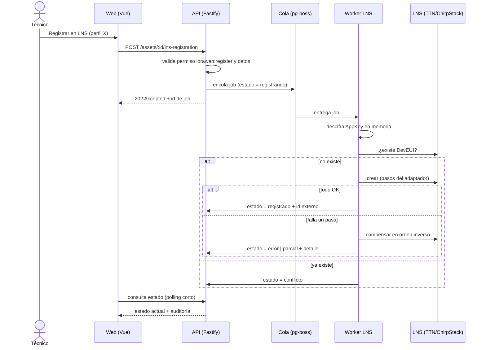
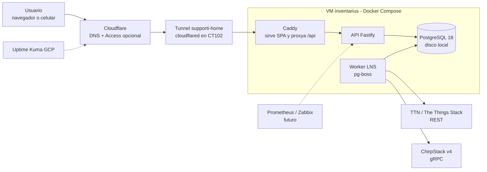
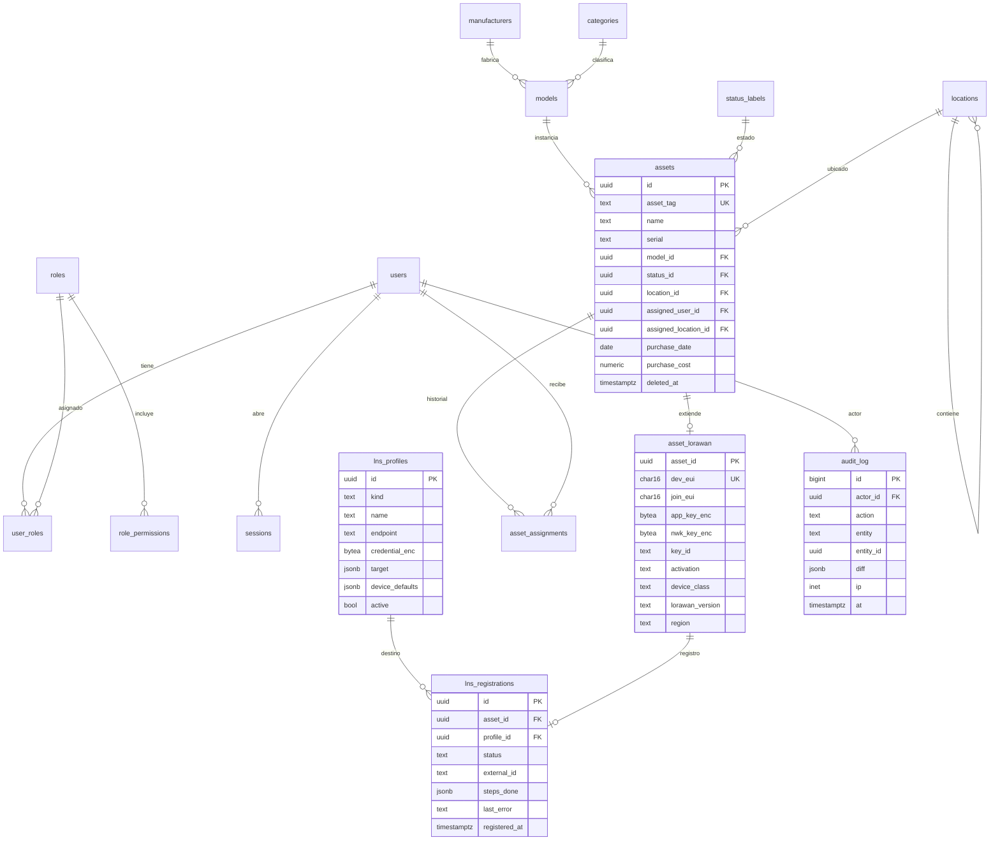
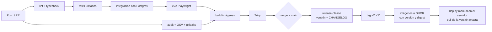

# Inventarius — Requerimiento y diseño MVP

Nov 16, 2026 · @Yatto · Estado: borrador v0.1

## 1. Resumen

**Inventarius** es una aplicación web de inventario de activos (estilo Snipe-IT), construida desde cero, simple y modular. Su diferencia: los activos de tipo **dispositivo LoRaWAN** se pueden registrar directamente en un Network Server (**ChirpStack v4** o **The Things Stack / TTN v3**) desde la ficha del activo, usando conexiones configuradas previamente como **perfiles LNS** dentro de la app.

Despliegue inicial: `inventarius.supporti.cl` (homelab pve-z420). Requisito de diseño: debe poder migrarse sin cambios de código a otra infraestructura (por ejemplo, servidores de Zensi), solo cambiando configuración.

### Objetivos del MVP

1. Registrar y consultar activos con su ciclo básico: alta, asignación (check-out / check-in), cambio de estado, baja e historial.
2. Usuarios con roles y permisos; todo cambio queda auditado.
3. Gestionar perfiles LNS (ChirpStack y TTN) y registrar / dar de baja un dispositivo LoRaWAN OTAA desde su ficha, con estado visible y reintento.
4. Interfaz responsiva y usable en celular en terreno, con buenas prácticas de UX/UI y accesibilidad.
5. Base técnica lista para crecer: versiones trabadas, migraciones versionadas, pruebas automáticas, CI, logs estructurados, métricas y health checks.

### Fuera de alcance del MVP

- Licencias de software, consumibles, accesorios y componentes (módulos de Snipe-IT que vienen después).
- Campos personalizados genéricos por categoría (el MVP solo trae la extensión LoRaWAN fija).
- Activación ABP, registro masivo, sincronización bidireccional con el LNS, lectura de uplinks o telemetría.
- Modo offline, app nativa, SSO/LDAP, API tokens para terceros, multiempresa.
- Adjuntos y fotos (se deja el modelo preparado).

## 2. Lluvia de ideas priorizada

Todo lo que salió, clasificado con MoSCoW. **Must** = MVP. **Should** = entra si sobra tiempo en el MVP, si no es la primera iteración post-MVP. **Could / Won't (por ahora)** = backlog.

| Idea | Prioridad | Nota |
| --- | --- | --- |
| Activos, modelos, categorías, fabricantes, ubicaciones, estados | Must | Núcleo tipo Snipe-IT |
| Check-out / check-in a usuario o ubicación, historial por activo | Must |  |
| Usuarios, roles, permisos, auditoría | Must |  |
| Perfiles LNS ChirpStack y TTN con prueba de conexión | Must |  |
| Registro y baja OTAA de un dispositivo en el LNS | Must |  |
| Cifrado de AppKeys y API keys en reposo | Must |  |
| UI responsiva + vistas móviles, PWA instalable (sin offline) | Must |  |
| Health checks, métricas Prometheus, logs JSON | Must |  |
| Búsqueda y filtros en listados, paginación del lado servidor | Must |  |
| Etiqueta con QR por activo e impresión | Should | Clave para terreno |
| Escanear QR con la cámara para abrir la ficha | Should |  |
| Importación CSV de activos LoRaWAN (DevEUI, JoinEUI, AppKey) | Should | Lotes de medidores |
| 2FA TOTP para usuarios administradores | Should |  |
| Registro masivo en LNS desde un lote importado | Could |  |
| Verificación de estado contra el LNS (último visto, joined) | Could |  |
| Campos personalizados por categoría | Could | Base para otros tipos de dispositivo |
| Adjuntos y fotos (instalación, factura) | Could |  |
| Mantenimientos y garantías con alertas | Could |  |
| API tokens con alcance para integraciones (n8n, GLPI) | Could |  |
| Dashboard de resumen | Could |  |
| Modo offline en terreno | Won't por ahora | Complejidad alta (sincronización, conflictos) |
| SSO (OIDC), LDAP | Won't por ahora | Se deja la capa de auth desacoplada |
| Otros LNS (Loriot, Actility, Helium) | Won't por ahora | Entran como nuevos adaptadores |

## 3. Roles y permisos (RBAC)

Modelo: **permisos atómicos** (`recurso:acción`) agrupados en **roles**. Un usuario tiene uno o más roles. El backend valida permisos en cada endpoint; el frontend solo oculta lo que el usuario no puede hacer (nunca es la barrera de seguridad).

El MVP trae cuatro roles semilla. Un administrador puede crear roles nuevos y editar la matriz de permisos de los roles no protegidos. El rol Administrador no se puede borrar ni quedarse sin al menos un usuario activo.

| Permiso | Administrador | Operador | Técnico de campo | Lector |
| --- | --- | --- | --- | --- |
| `asset:read` | Sí | Sí | Sí | Sí |
| `asset:write` (crear, editar, cambiar estado) | Sí | Sí | No | No |
| `asset:checkout` (asignar / devolver) | Sí | Sí | Sí | No |
| `asset:delete` (baja lógica) | Sí | Sí | No | No |
| `catalog:write` (modelos, categorías, fabricantes, ubicaciones, estados) | Sí | Sí | No | No |
| `lorawan:read` | Sí | Sí | Sí | Sí |
| `lorawan:register` (registrar / dar de baja en LNS) | Sí | Sí | Sí | No |
| `lorawan:keys:reveal` (ver AppKey en claro) | Sí | No | No | No |
| `lns_profile:manage` | Sí | No | No | No |
| `user:manage`, `role:manage` | Sí | No | No | No |
| `audit:read` | Sí | Sí | No | No |

Reglas:

- Revelar una AppKey o una API key exige permiso explícito, se registra en auditoría y la clave se muestra enmascarada por defecto.
- El Técnico de campo puede registrar en el LNS pero no ver claves: el backend las usa sin exponerlas.
- Post-MVP: restringir permisos por ubicación (alcance), si aparece la necesidad.

## 4. Requerimientos funcionales del MVP

Cada requerimiento tiene ID para trazarlo en issues, commits y tests (`RF-xx`).

### 4.1 Autenticación y usuarios

- **RF-01** Login con email y contraseña; sesión por cookie segura; logout; expiración por inactividad configurable (por defecto 8 h) y expiración absoluta configurable (por defecto 24 h) aunque haya actividad. Un job periódico de pg-boss, cada hora, purga las sesiones vencidas.
- **RF-02** Primer arranque: un comando CLI (`pnpm --filter api cli create-admin`) crea el primer administrador. No existe registro público.
- **RF-03** CRUD de usuarios (nombre, email, roles, activo/inactivo). Un usuario inactivo no puede entrar y sus sesiones se invalidan. Solo un administrador da de alta y edita el correo; nadie edita su propio correo (ni un administrador, lo hace otro); el comando CLI `update-email` lo cambia para cualquier usuario, incluido el único administrador, con actor `cli` en la auditoría. Un cambio de correo invalida las sesiones de esa persona y queda en auditoría con antes/después.
- **RF-04** Cambio de contraseña propio; reseteo por un administrador (genera contraseña temporal de un uso, obliga a cambiarla al entrar). Sin correo en el MVP.
- **RF-05** Bloqueo temporal tras intentos fallidos repetidos (por cuenta y por IP).

### 4.2 Catálogo

- **RF-10** CRUD de **categorías** (nombre, tipo de extensión: `ninguna` | `lorawan`).
- **RF-11** CRUD de **fabricantes** y **modelos** (nombre, número de modelo, fabricante, categoría). En modelos LoRaWAN: clase por defecto (A/B/C), versión LoRaWAN y regional parameters por defecto.
- **RF-12** CRUD de **ubicaciones** jerárquicas (ej.: Cliente > Edificio > Piso > Sala) con dirección opcional.
- **RF-13** CRUD de **estados** con tipo: `desplegable`, `pendiente`, `no desplegable`, `archivado`. Semilla: Disponible, Asignado, En reparación, Dañado, Dado de baja.
- **RF-14** No se puede borrar un elemento del catálogo en uso; se puede desactivar.

### 4.3 Activos

- **RF-20** Alta de activo: etiqueta (asset tag, única, autogenerable con prefijo configurable), nombre, modelo, número de serie, estado, ubicación, fecha y costo de compra, proveedor, garantía (meses), notas.
- **RF-21** Si la categoría del modelo es `lorawan`, la ficha agrega la sección LoRaWAN (ver 5.2), con validación de formato y unicidad de DevEUI.
- **RF-22** Listado con búsqueda de texto (etiqueta, nombre, serie, DevEUI), filtros (categoría, modelo, estado, ubicación, asignado a, estado LNS), orden y paginación del lado servidor. Los filtros quedan en la URL (compartibles).
- **RF-23** Check-out a usuario o a ubicación, con fecha esperada de devolución opcional y nota; check-in con nota y nuevo estado. Solo activos en estado `desplegable` pueden asignarse.
- **RF-24** Historial por activo: línea de tiempo con creación, cambios de campos (antes/después), asignaciones y operaciones LNS.
- **RF-25** Baja lógica (soft delete) con motivo; restaurable por un administrador.
- **RF-26** Exportación CSV del listado filtrado (sin claves).

### 4.4 Auditoría

- **RF-30** Toda escritura (y todo reveal de clave) registra: quién, cuándo, IP, acción, entidad, id y diff. Tabla append-only; la app no expone edición ni borrado.
- **RF-31** Vista de auditoría filtrable por usuario, entidad, acción y rango de fechas.

### 4.5 Experiencia móvil

- **RF-40** Todas las vistas usables desde 360 px de ancho. En móvil: navegación inferior o menú colapsable, listados como tarjetas, acciones principales al alcance del pulgar.
- **RF-41** Ficha de activo optimizada para terreno: datos clave arriba, botones Asignar, Cambiar estado y Registrar en LNS visibles sin scroll.
- **RF-42** PWA instalable (manifest e íconos). Sin modo offline en el MVP: si no hay red, se muestra un aviso claro.

## 5. Integración LoRaWAN

### 5.1 Perfiles LNS

Un **perfil LNS** es una conexión guardada a un Network Server más los valores por defecto con que se registran los dispositivos. Se gestiona en Configuración > Perfiles LNS (permiso `lns_profile:manage`).

| Campo | ChirpStack v4 | TTN / The Things Stack v3 |
| --- | --- | --- |
| Nombre, descripción, activo | Sí | Sí |
| Endpoint | Host:puerto gRPC (por defecto 8080), TLS sí/no | URL del cluster (ej. `https://au1.cloud.thethings.network`) o instancia propia |
| Credencial (cifrada) | API key (se crea en la UI o la CLI de ChirpStack; no se puede crear por API) | API key de la aplicación con derechos de lectura/escritura de dispositivos y escritura de claves |
| Destino | `tenant_id`, `application_id` | `application_id` |
| Defaults de dispositivo | `device_profile_id` | `frequency_plan_id`, versión MAC LoRaWAN, versión PHY, `join_server_address`, `network_server_address`, `application_server_address` |

- **RF-50** CRUD de perfiles. La credencial nunca vuelve al frontend después de guardada: se muestra como `•••• últimos 4` y se puede reemplazar, no leer.
- **RF-51** Botón **Probar conexión**: valida credencial y que existan tenant/aplicación/device profile (ChirpStack) o aplicación (TTN). Muestra resultado y latencia.
- **RF-52** Un perfil con dispositivos registrados no se puede borrar, solo desactivar.

### 5.2 Datos LoRaWAN del activo

Extensión 1:1 del activo: **DevEUI** (16 hex, único), **JoinEUI / AppEUI** (16 hex), **AppKey** (32 hex, cifrada), **NwkKey** (32 hex, cifrada, solo LoRaWAN 1.1), activación (`OTAA` en el MVP), clase, versión LoRaWAN, región. Los hex se normalizan a mayúsculas sin separadores.

### 5.3 Registro y baja

- **RF-60** Desde la ficha: **Registrar en LNS** > elegir perfil > vista previa de lo que se enviará (sin claves) > confirmar.
- **RF-61** La operación corre como **job en segundo plano** (cola en Postgres) y la ficha muestra el estado en vivo: `no registrado` → `registrando` → `registrado` | `error` | `parcial`. Se guarda el id externo, el perfil, la fecha y el último error legible.
- **RF-62** **Dar de baja en LNS**: borra el dispositivo en el LNS en orden inverso y deja el activo en `no registrado`.
- **RF-63** **Reintentar** desde `error` o `parcial`. Reintentos automáticos con backoff solo para errores transitorios (timeout, 5xx, `UNAVAILABLE`); los 4xx / `INVALID_ARGUMENT` / `ALREADY_EXISTS` no se reintentan.
- **RF-64** Idempotencia: antes de crear se consulta si el DevEUI ya existe en el destino. Si existe y no fue creado por Inventarius, el job termina en `conflicto` y ofrece **Vincular** (tomarlo como registrado sin tocarlo) o cancelar.
- **RF-65** Un activo solo puede estar registrado en un perfil a la vez en el MVP.

### 5.4 Pasos por proveedor

**ChirpStack v4** (API gRPC nativa, cliente oficial `@chirpstack/chirpstack-api` + `@grpc/grpc-js`; se descarta el proxy REST porque es un componente aparte y ChirpStack recomienda gRPC):

1. `DeviceService.Get(dev_eui)` para chequear existencia.
2. `DeviceService.Create` con `dev_eui`, `name`, `application_id`, `device_profile_id`, `description` y tag `inventarius_asset_id`.
3. `DeviceService.CreateKeys`: en dispositivos LoRaWAN 1.0.x la AppKey va en el campo `nwk_key` (así lo muestra la UI de ChirpStack como Application key); en 1.1 van `nwk_key` y `app_key`. **Verificar contra la versión instalada en la primera prueba de integración.**
4. Si falla el paso 3, compensar con `DeviceService.Delete`.

**TTN / The Things Stack v3** (REST, el dispositivo vive repartido en cuatro componentes):

1. Identity Server: `POST /api/v3/applications/{app}/devices` (ids, direcciones de JS/NS/AS).
2. Join Server: `PUT /api/v3/js/applications/{app}/devices/{id}` (root keys, solo OTAA).
3. Network Server: `PUT /api/v3/ns/applications/{app}/devices/{id}` (versión MAC/PHY, plan de frecuencias, `supports_join`).
4. Application Server: `PUT /api/v3/as/applications/{app}/devices/{id}`.
5. Cada request lleva `field_mask` explícito. Si falla un paso, se borra en orden inverso lo ya creado (AS → NS → JS → IS). Si la compensación también falla, el estado queda `parcial` con el detalle de qué componente quedó huérfano.
6. `device_id` en TTN: derivado y estable, `inv-` + DevEUI en minúsculas (cumple el formato de ids de TTN).



### 5.5 Contrato del adaptador

Cada LNS es un módulo que implementa la misma interfaz; agregar un LNS nuevo no toca el dominio de activos.

```ts
/** Contrato que implementa cada Network Server soportado. */
export interface LnsAdapter {
  readonly kind: 'chirpstack' | 'ttn';
  /** Verifica credencial y que el destino configurado exista. */
  testConnection(profile: LnsProfile): Promise<ConnectionCheck>;
  /** Devuelve el dispositivo si existe en el destino, o null. */
  findDevice(profile: LnsProfile, devEui: string): Promise<RemoteDevice | null>;
  /** Crea el dispositivo completo; compensa internamente si falla a mitad. */
  registerDevice(profile: LnsProfile, device: LorawanDeviceSecrets): Promise<RegistrationResult>;
  /** Borra el dispositivo del destino en el orden que corresponda. */
  deregisterDevice(profile: LnsProfile, ref: RemoteDeviceRef): Promise<void>;
}
```

Los adaptadores se prueban contra dobles (fake gRPC server y mock HTTP) en CI, y contra una instancia real de prueba solo en un job manual.

## 6. Requerimientos no funcionales

| ID | Área | Requerimiento |
| --- | --- | --- |
| RNF-01 | UX/UI | Sistema de diseño único basado en Nuxt UI v4 (tema propio por design tokens en `apps/web/src/theme`; Tailwind v4 solo para layout y espaciado; íconos Lucide empaquetados en el build). Tokens de color, tipografía y espaciado centralizados; nada de estilos sueltos por vista. Modo claro y oscuro. |
| RNF-02 | Accesibilidad | WCAG 2.2 nivel AA: contraste, foco visible, navegación por teclado, labels en formularios, objetivos táctiles de al menos 44 px en móvil. Se valida con axe en los tests e2e. |
| RNF-03 | Responsivo | Mobile-first. Puntos de quiebre Tailwind estándar; probado en 360, 768 y 1280 px. |
| RNF-04 | Patrones de UX | Estados vacíos, de carga (skeleton) y de error en cada vista. Confirmación solo en acciones destructivas. Feedback de cada acción (toast). Mensajes de error accionables, sin jerga técnica. |
| RNF-05 | Idioma | Español (Chile) por defecto; todo texto pasa por i18n desde el día 1 para poder agregar inglés. Fechas en zona horaria configurable (por defecto `America/Santiago`), guardadas en UTC. |
| RNF-06 | Rendimiento | API p95 < 300 ms en lecturas con 10.000 activos; listados siempre paginados (máx. 100 por página). Bundle inicial del frontend < 250 KB gzip; rutas con carga diferida. |
| RNF-07 | Disponibilidad | Objetivo homelab: reinicio automático de contenedores, arranque sin intervención tras reboot del host. Sin HA en el MVP. |
| RNF-08 | Portabilidad | Toda configuración por variables de entorno (12-factor). Sin dominio, IP ni ruta del homelab escritos en código. Despliegue completo con `docker compose up` + migraciones. Guía de instalación en `docs/`. |
| RNF-09 | Versiones trabadas | Lockfile commiteado, dependencias con versión exacta, Node y pnpm fijados, imágenes Docker fijadas por digest. Actualizaciones solo vía PR (Renovate) con CI en verde. |
| RNF-10 | Versionamiento | SemVer para la app, Conventional Commits, CHANGELOG generado, tags `vX.Y.Z` e imágenes etiquetadas con la misma versión. Esquema de BD versionado por migraciones. API bajo prefijo `/api/v1`. |
| RNF-11 | Calidad de código | TypeScript estricto en todo el repo, ESLint + Prettier, sin `any` implícito, módulos con límites claros, funciones pequeñas, comentarios donde explican el porqué (no el qué). |
| RNF-12 | Pruebas | Cobertura mínima 80 % en dominio y servicios del backend, 70 % global. Tests de integración contra Postgres real (contenedor). E2E de los flujos críticos en escritorio y móvil. |
| RNF-13 | Observabilidad | Logs JSON estructurados con request id, health checks, métricas Prometheus. Ver sección 11. |
| RNF-14 | Seguridad | Ver sección 10. OWASP ASVS nivel 2 como referencia. |
| RNF-15 | Datos | Respaldo diario de la BD con `pg_dump`, retención configurable, restauración probada y documentada. |

## 7. Arquitectura y stack

### 7.1 Estilo

**Monolito modular**: una API con módulos de dominio aislados (auth, users, rbac, audit, catalog, assets, lorawan, lns), un worker que comparte código y consume la cola, y un frontend SPA. Un solo despliegue, límites claros entre módulos, y la opción de separar un módulo en servicio el día que haga falta. Microservicios en el MVP serían sobreingeniería.

Reglas de módulos: cada módulo expone un plugin Fastify (rutas) y un servicio público; ningún módulo lee tablas de otro directamente. Capas internas: `routes` (HTTP) → `service` (reglas de negocio) → `repository` (SQL). Los adaptadores externos (LNS, cifrado, reloj) se inyectan para poder testearlos.



SPA y API se sirven en el **mismo origen** (`/` y `/api`): cookies de sesión sin CORS ni tokens en el navegador.

### 7.2 Stack y versiones

Regla: se fija la versión exacta en la Fase 0 con el lockfile y se registra en `docs/adr/0002-stack.md`. Lo de abajo es la línea base.

| Capa | Elección | Motivo |
| --- | --- | --- |
| Runtime | Node.js 26 LTS (CI también en 24 LTS como respaldo) | 26 pasó a LTS en octubre 2026, soporte hasta abril 2029; 24 queda hasta abril 2028 |
| Gestor de paquetes | pnpm (fijado con `packageManager` + corepack), workspaces | Monorepo, lockfile estricto |
| Lenguaje | TypeScript estricto en front, back y paquete compartido | Tipos de punta a punta |
| Frontend | Vue 3 (Composition API, `<script setup>`), Vite, Vue Router, Pinia, vue-i18n, TanStack Query (Vue) | Recomendación de Carlos (Zensi) + caché y estados de carga sin código repetido |
| UI | Nuxt UI v4 (MIT) en modo Vue + Vite, sin Nuxt (`@nuxt/ui/vite`), tema propio por design tokens; Tailwind CSS v4 solo para layout; íconos Lucide (`@iconify-json/lucide`) empaquetados en el build | Reemplaza a Volt, propuesto por Carlos, y a PrimeVue, que desde la v5 exige licencia con clave (ver 7.3 y ADR 0004) |
| Backend | Fastify 5.x con `fastify-type-provider-zod`, `@fastify/helmet`, `@fastify/rate-limit`, `@fastify/cookie`, `@fastify/csrf-protection`, `@fastify/swagger`, `@fastify/under-pressure` | Recomendación de Carlos; Fastify 6 sigue en alpha, no se usa |
| Validación | Zod en `packages/shared`, mismo esquema en API y formularios | Una sola fuente de verdad |
| Contrato API | OpenAPI 3.1 generado desde las rutas; cliente del front tipado generado desde ese OpenAPI | El front no puede desalinearse de la API |
| Base de datos | PostgreSQL 18 | Recomendación de Carlos |
| ORM / migraciones | Drizzle ORM + drizzle-kit (migraciones SQL versionadas en el repo) | SQL explícito, tipos, migraciones revisables |
| Cola de jobs | pg-boss (sobre el mismo Postgres); primer uso: purga horaria de sesiones vencidas | Sin Redis: un servicio menos |
| Cliente ChirpStack | `@chirpstack/chirpstack-api` + `@grpc/grpc-js` | Cliente oficial, gRPC recomendado |
| Cliente TTN | `fetch` nativo (undici) con capa propia tipada | API REST simple |
| Cripto | `argon2` (hash de contraseñas, argon2id), `node:crypto` AES-256-GCM | Estándares actuales |
| Logs / métricas | pino (nativo de Fastify), `fastify-metrics` (Prometheus) |  |
| Pruebas | Vitest, Vue Test Utils, Testcontainers (Postgres), Playwright + axe |  |
| Contenedores | Docker + Compose, Caddy como proxy y servidor estático | Paridad dev/prod |
| Calidad | ESLint, Prettier, commitlint, lefthook (git hooks), Renovate |  |

### 7.3 Decisión de UI: Nuxt UI v4 (reemplaza a Volt y a PrimeVue)

Se registra como `docs/adr/0004-ui-nuxt-ui-v4.md`, que reemplaza a `docs/adr/0003-ui-primevue-styled.md`.

**Contexto.** Carlos (Zensi) propuso Vue + Volt; Volt copia los componentes al repositorio, por lo que pasan a ser código propio. La primera respuesta fue PrimeVue en modo styled (ADR 0003). Desde la versión 5, PrimeVue y todo PrimeTek (incluido Volt) exigen una licencia con clave: la versión gratuita solo cubre organizaciones chicas y se renueva cada año. Eso choca con RNF-08 (portabilidad a otras organizaciones).

**Decisión.** Usar Nuxt UI v4 (MIT) en modo Vue + Vite, sin Nuxt, instalado por npm, con el tema propio por design tokens en `apps/web/src/theme`. Tailwind v4 se mantiene para layout y espaciado. Los íconos son Lucide, empaquetados en el build: nunca se piden en runtime a otro dominio, para mantener una CSP estricta.

**Por qué.**

1. **Licencia.** MIT en Nuxt UI y en sus bases (`reka-ui`, Tailwind): cualquier organización puede instalar Inventarius sin condiciones de un tercero.
2. **Actualizaciones.** Paquete npm: las correcciones llegan por Renovate, quedan trabadas en el lockfile y pasan por CI (RNF-09, RNF-10). Sin componentes copiados.
3. **Sistema de diseño.** Los tokens centralizan color, tipografía, radios y modo oscuro en un solo lugar (RNF-01).
4. **Accesibilidad.** Base `reka-ui`; los e2e con axe cubren claro/oscuro, escritorio y 360 px, con diálogos y selects abiertos (RNF-02).

**Costos aceptados.** La tabla es menos completa que el `DataTable` de PrimeVue: paginación y filtros del lado servidor se arman sobre `UTable`/TanStack. Más superficie de dependencias.

**Reversibilidad.** Media: cambiar de librería afecta plantillas y tema, no la lógica ni la API.

## 8. Modelo de datos

Convenciones: claves primarias UUID v7, nombres en `snake_case` e inglés, `created_at` / `updated_at` en `timestamptz`, baja lógica con `deleted_at` donde aplica, índice en toda FK, emails en `citext`. Columnas secretas en `bytea` cifradas con AES-256-GCM más `key_id` para rotar la clave maestra.



Notas:

- `permissions` es un catálogo fijo definido en código y sembrado por migración; `role_permissions` lo referencia.
- `lns_registrations.steps_done` guarda qué pasos se completaron (clave para compensar en TTN).
- `audit_log` no tiene `UPDATE` ni `DELETE` desde la app; el usuario de BD de la app no tiene esos privilegios sobre esa tabla.
- pg-boss crea su propio esquema (`pgboss`); no se mezcla con las tablas de negocio.

## 9. API, repositorio y estándares

### 9.1 Convenciones de la API

- REST JSON bajo `/api/v1`. Recursos en plural (`/assets`, `/lns-profiles`). Cambios incompatibles = `/api/v2`.
- Listados: `?page=&pageSize=&sort=&q=&filter[campo]=`; respuesta `{ data, meta: { page, pageSize, total } }`.
- Errores en formato RFC 9457 (`application/problem+json`) con `type`, `title`, `status`, `detail` y `errors` por campo.
- Operaciones largas (registro LNS) responden `202` con el recurso de estado.
- Concurrencia optimista: `PATCH` exige `If-Match` con la versión (`updated_at` o `etag`) para no pisar ediciones simultáneas.
- Documentación Swagger UI en `/api/docs`, solo con sesión de administrador o fuera de producción.

Endpoints mínimos del MVP: `auth` (login, logout, me, change-password), `users`, `roles`, `permissions` (lectura), `categories`, `manufacturers`, `models`, `locations`, `status-labels`, `assets` (+ `/checkout`, `/checkin`, `/history`, `/restore`, `/export`), `assets/:id/lorawan` (+ `/reveal-keys`), `assets/:id/lns-registration` (POST registrar, DELETE baja, GET estado, POST `/retry`, POST `/link`), `lns-profiles` (+ `/test`), `audit`, `health/live`, `health/ready`, `metrics`.

### 9.2 Estructura del repositorio

```text
inventarius/
├── apps/
│   ├── api/                 # Fastify: API + worker (mismo código, distinto entrypoint)
│   │   ├── src/
│   │   │   ├── core/        # config, db, logger, errores, crypto, auth hooks
│   │   │   ├── modules/     # un directorio por módulo de dominio
│   │   │   │   └── assets/  # routes.ts, service.ts, repository.ts, schemas.ts, *.test.ts
│   │   │   ├── integrations/lns/  # chirpstack/, ttn/, adapter.ts
│   │   │   ├── jobs/        # handlers de pg-boss
│   │   │   ├── server.ts    # entrypoint HTTP
│   │   │   └── worker.ts    # entrypoint worker
│   │   └── drizzle/         # migraciones SQL versionadas
│   └── web/                 # Vue + Nuxt UI
│       └── src/
│           ├── app/         # router, layout, guards, i18n
│           ├── features/    # una carpeta por funcionalidad (assets, lns, users...)
│           ├── theme/       # design tokens de Nuxt UI (theme.ts, theme.css)
│           ├── shared/      # cliente API generado, composables, utilidades
│           └── styles/      # tokens y Tailwind
├── packages/
│   └── shared/              # esquemas Zod, permisos, enums, tipos
├── e2e/                     # Playwright
├── deploy/                  # compose.prod.yml, Caddyfile, ejemplos de .env
├── docs/
│   ├── adr/                 # decisiones de arquitectura numeradas
│   ├── requirements.md      # este documento exportado
│   ├── install.md, operations.md, security.md
├── CLAUDE.md                # reglas para Claude Code (sección 14)
├── compose.yml              # entorno de desarrollo
└── .github/workflows/       # CI
```

### 9.3 Estándares de código

- Una responsabilidad por archivo y por función. Sin lógica de negocio en rutas ni en componentes Vue: va en servicios (back) y composables (front).
- Nombres en inglés en código y BD; textos de UI en español vía i18n.
- Comentarios: TSDoc en funciones públicas de servicios y adaptadores; comentarios en línea solo para explicar decisiones no obvias. Nada de código comentado.
- Errores tipados del dominio (`NotFoundError`, `ConflictError`, `ForbiddenError`...) mapeados a HTTP en un solo lugar.
- Sin acceso a `process.env` fuera de `core/config` (validado con Zod al arrancar: si falta algo, la app no parte).
- Toda decisión de arquitectura relevante queda como ADR corto en `docs/adr/`.
- Componentes Vue: `<script setup lang="ts">`, props y emits tipados, máximo \~200 líneas; si crece, se divide.

## 10. Seguridad

### 10.1 Controles del MVP

| Área | Control |
| --- | --- |
| Contraseñas | argon2id con parámetros OWASP vigentes; mínimo 12 caracteres; chequeo contra lista de contraseñas comunes. |
| Sesiones | ID aleatorio guardado en Postgres (hash), cookie `HttpOnly`, `Secure`, `SameSite=Strict`, prefijo `__Host-`; rotación del ID al hacer login; expiración absoluta e inactiva; invalidación al desactivar usuario o cambiar contraseña. |
| CSRF | Token doble (`@fastify/csrf-protection`) en toda petición que modifica estado, además de `SameSite=Strict`. |
| Fuerza bruta | Rate limit global y específico en login (por IP y por cuenta), bloqueo temporal progresivo. |
| Autorización | Chequeo de permiso en cada ruta mediante un decorador declarativo (`requirePermission('asset:write')`); test que falla si una ruta no declara permiso. |
| Entrada | Validación Zod en toda ruta (body, query, params); SQL siempre parametrizado vía Drizzle; nada de SQL concatenado. |
| Cabeceras | Helmet con CSP estricta (sin `unsafe-inline` en scripts), HSTS, `frame-ancestors 'none'`, `Referrer-Policy`. |
| Secretos en BD | AppKey, NwkKey y credenciales LNS cifradas con AES-256-GCM (IV aleatorio por valor, AAD = tabla + id). Clave maestra `APP_ENCRYPTION_KEY` (32 bytes) solo en el `.env` del servidor; soporta rotación con `key_id`. Nunca salen en logs, exportaciones ni respuestas salvo el reveal autorizado y auditado. |
| Logs | Redacción en pino de `authorization`, `cookie`, `password`, `*key*`, `*token*`. |
| Base de datos | Dos usuarios: `inventarius_migrator` (DDL, solo al migrar) e `inventarius_app` (DML, sin `UPDATE`/`DELETE` en `audit_log`). Postgres no expuesto fuera de la red de Compose. |
| Contenedores | Usuario no root, sistema de archivos de solo lectura donde se pueda, `no-new-privileges`, sin capacidades extra, imágenes base mínimas fijadas por digest. |
| Cadena de suministro | Lockfile, `pnpm audit` y OSV-Scanner en CI, Trivy sobre las imágenes, gitleaks contra secretos commiteados, Renovate para parches, revisión humana de toda dependencia nueva. |
| Repositorio | `.env` en `.gitignore` desde el primer commit; solo `.env.example`. Rama `main` protegida: PR + CI verde. |
| Exposición | Solo por Cloudflare Tunnel; ningún puerto abierto en el router. Recomendado durante el MVP: Cloudflare Access delante de `inventarius.supporti.cl` (segunda barrera antes del login de la app). |

### 10.2 Amenazas principales

| Amenaza | Impacto | Mitigación |
| --- | --- | --- |
| Robo de AppKeys desde la BD o un respaldo | Suplantación de dispositivos en la red | Cifrado en reposo con clave fuera de la BD; respaldos sin la clave maestra |
| Robo de API key de un LNS | Alta / baja de dispositivos ajenos | Cifrado, API keys con el mínimo de derechos y acotadas a una aplicación |
| Usuario con más permisos de los necesarios | Cambios o fugas internas | RBAC + auditoría + reveal explícito |
| XSS en campos libres (notas, nombres) | Robo de sesión o acciones en nombre del usuario | Escape por defecto de Vue, sin `v-html`, CSP estricta |
| Dependencia comprometida | Ejecución de código | Versiones exactas, auditoría en CI, Renovate con revisión |
| Claude Code con acceso de más | Daño fuera del proyecto | VM aislada, sin acceso a la LAN ni a producción (sección 12) |

## 11. Observabilidad, pruebas y CI/CD

### 11.1 Observabilidad

- **Logs**: JSON con pino; cada línea con `reqId`, usuario (id, no email), ruta, status y duración. Nivel configurable por entorno. En producción van a stdout y Docker los rota (`max-size`, `max-file`).
- **Health**: `GET /api/health/live` (proceso vivo) y `GET /api/health/ready` (BD y cola disponibles). Los usa Docker (healthcheck) y Uptime Kuma.
- **Métricas** Prometheus en `/api/metrics`, accesible solo desde la red interna o con token: latencia y conteo por ruta, errores, conexiones a BD, tamaño de cola, jobs LNS por resultado y proveedor, logins fallidos.
- **Sobrecarga**: `@fastify/under-pressure` responde `503` si el event loop o la memoria se degradan.
- **Post-MVP**: trazas OpenTelemetry, panel Grafana o integración con el Zabbix previsto para el homelab, captura de errores del frontend (GlitchTip).

### 11.2 Pruebas

| Nivel | Herramienta | Qué cubre |
| --- | --- | --- |
| Unitarias back | Vitest | Servicios, reglas de negocio, cifrado, validaciones, adaptadores LNS con dobles |
| Integración back | Vitest + `fastify.inject` + Testcontainers (Postgres 18) | Rutas completas con BD real, permisos, migraciones desde cero |
| Unitarias front | Vitest + Vue Test Utils | Composables, componentes con lógica, guards |
| E2E | Playwright (escritorio y viewport móvil) + axe | Login, CRUD de activo, check-out/in, perfil LNS, registro LNS contra LNS falso, permisos por rol |
| Contrato LNS | Servidor gRPC falso (ChirpStack) y mock HTTP (TTN) | Orden de pasos, compensación, errores transitorios vs definitivos |
| Integración real LNS | Job manual en CI con credenciales de prueba | Una aplicación de prueba en TTN y, si hay, una instancia ChirpStack de prueba |

Reglas: todo bug corregido trae su test; ningún test depende de servicios externos reales salvo el job manual; datos de prueba con fábricas, nunca datos reales de clientes.

### 11.3 CI/CD (GitHub Actions)



- Despliegue: el servidor hace `pull` de una versión etiquetada (nunca `latest`), corre migraciones como paso separado y reinicia. Rollback = volver a la versión anterior (las migraciones se escriben compatibles hacia atrás una versión).
- Este flujo reemplaza, para esta app, el patrón `git fetch` + `reset --hard` de supporti-web: con backend y BD conviene desplegar imágenes construidas y probadas en CI.

## 12. Entornos

### 12.1 VM de desarrollo para Claude Code

Claude Code trabaja en una VM dedicada dentro del Proxmox, aislada del resto del homelab. Respeta la regla vigente del homelab: Claude Code no tiene shell en el host ni en los CTs existentes; solo en su VM.

| Aspecto | Propuesta |
| --- | --- |
| Tipo | VM (no LXC): Docker dentro de una VM aísla mejor y evita relajar un LXC unprivileged |
| SO | Debian 13 |
| Recursos | 4 vCPU, 8 GB RAM, 60 GB en `local-lvm` (Postgres, Playwright con navegadores y una instancia ChirpStack de prueba en Docker) |
| Red | IP fija fuera del DHCP. Firewall de Proxmox en la NIC de la VM: salida a Internet permitida, **todo `192.168.100.0/24` bloqueado** salvo gateway y DNS. Sin montajes NFS. |
| Software | Docker + Compose, Node vía la versión fijada del repo (corepack), git, `gh`, Claude Code |
| Credenciales | Solo las del repo: token fine-grained de GitHub limitado a `inventarius` (contenido y PRs). Ninguna credencial de producción, del homelab ni de Zensi. Credenciales LNS solo de aplicaciones de prueba. |
| Control | Rama `main` protegida: Claude Code trabaja en ramas y abre PRs; Rodrigo revisa y hace merge. Snapshot de Proxmox antes de cada fase para volver atrás rápido. |
| Acceso | SSH con llave dedicada desde el ThinkPad (o conexión SSH de Claude Desktop), también por Tailscale si se agrega el nodo con ACL acotada |

La VM corre el entorno completo de desarrollo (`compose.yml`: Postgres, ChirpStack de prueba, API, worker, web con Vite) para que todas las pruebas pasen localmente antes del push.

### 12.2 Producción inicial: `inventarius.supporti.cl`

| Aspecto | Propuesta |
| --- | --- |
| Tipo | VM Debian 13 con Docker Compose, `onboot: 1` |
| Recursos | 2 vCPU, 3 GB RAM, 32 GB en `local-lvm` (la BD en disco local, nunca sobre NFS) |
| Servicios | `caddy` (estáticos + proxy), `api`, `worker`, `postgres`; imágenes desde GHCR con versión fija |
| Exposición | Nueva ruta en el Tunnel `supporti-home` → `http://<ip-vm>:80`. Sin puertos en el router. Cloudflare Access recomendado. |
| Secretos | `.env` solo en la VM (permisos 600), con copia de `APP_ENCRYPTION_KEY` en el gestor de contraseñas. Sin la clave, las AppKeys respaldadas son irrecuperables. |
| Respaldos | `pg_dump` diario (timer systemd) a un destino fuera de la VM; vzdump semanal la cubre por el job `--all 1` existente. Ojo: el vzdump incluye el `.env`, mismo criterio ya aceptado para los otros secretos del homelab. |
| Monitoreo | Uptime Kuma (GCP) contra `/api/health/ready`; métricas listas para el monitoreo centralizado cuando se instale. |

Portabilidad: mover la app a otro servidor = copiar `deploy/`, crear `.env`, `docker compose pull && docker compose run --rm migrate && docker compose up -d`, y restaurar el dump si se migran datos. Queda escrito paso a paso en `docs/install.md`.

## 13. Plan de entrega del MVP

Cinco fases. Cada una termina en un PR revisado y un tag de pre-release (`v0.1.0`, `v0.2.0`...). El MVP es `v1.0.0`. Claude Code no empieza una fase sin el merge de la anterior.

| Fase | Contenido | Criterio de aceptación |
| --- | --- | --- |
| F0 Fundaciones | Monorepo pnpm, TS estricto, lint/format, hooks, `compose.yml` de desarrollo, Fastify con config validada, logger, health, métricas, Drizzle con primera migración, esqueleto Vue + Nuxt UI (tema propio) + Tailwind + i18n + layout responsivo, Vitest y Playwright funcionando, CI completo, ADRs 0001-0004, `CLAUDE.md` | `pnpm i && docker compose up` levanta todo; CI verde; `/api/health/ready` responde; una página vacía con layout pasa axe en móvil y escritorio |
| F1 Identidad | RF-01 a RF-05, roles y permisos sembrados, decorador de permisos, sesiones, CSRF, rate limit, auditoría (RF-30, RF-31), gestión de usuarios y roles en UI | Tests de permisos por rol en todas las rutas; test que detecta rutas sin permiso; login, bloqueo y expiración probados en e2e |
| F2 Inventario | Catálogo RF-10 a RF-14, activos RF-20 a RF-26, historial, vistas móviles RF-40 a RF-42 | CRUD completo e2e en escritorio y móvil; listado con 10.000 activos sembrados dentro del objetivo de rendimiento |
| F3 LoRaWAN | Extensión LoRaWAN del activo, cifrado de claves, perfiles LNS RF-50 a RF-52, adaptadores ChirpStack y TTN, cola pg-boss y worker, RF-60 a RF-65 | Registro y baja OK contra ChirpStack de prueba en Docker; contra TTN con mock en CI y con una aplicación de prueba real en el job manual; compensación probada simulando fallo en cada paso |
| F4 Cierre | Endurecimiento (CSP, cabeceras, revisión de secretos en logs), `deploy/` de producción, respaldo y restauración probados, docs de instalación y operación, release-please, imágenes en GHCR | Despliegue en la VM de producción siguiendo solo `docs/install.md`; restauración desde dump verificada; `v1.0.0` publicado |

### Definición de terminado (cada PR)

- Lint, typecheck y todos los tests en verde; cobertura sobre el umbral.
- Requerimientos tocados citados por ID en el PR.
- Migraciones nuevas probadas desde cero y sobre la versión anterior.
- Textos de UI en i18n; vista revisada en 360 px.
- Documentación y ADR actualizados si cambió algo de arquitectura.
- Sin secretos, sin `console.log`, sin TODO sin issue asociado.

## 14. Reglas de trabajo para Claude Code

Este bloque es la base del `CLAUDE.md` en la raíz del repo.

```markdown
# CLAUDE.md — Inventarius

## Fuente de verdad
- docs/requirements.md (requerimiento y diseño del MVP). Si algo no está ahí, no se inventa:
  se anota en docs/open-questions.md y se sigue con otra tarea.
- docs/adr/ para decisiones de arquitectura.

## Alcance
- Trabajar solo la fase indicada (F0..F4). Una fase = una rama `phase/fN-nombre` = un PR.
- Detenerse al completar el MVP (v1.0.0). Nada de items Should/Could sin instrucción explícita.

## Forma de trabajo
- Antes de codificar una funcionalidad: test que falla, luego implementación (TDD en dominio y servicios).
- Commits pequeños, Conventional Commits, mensaje con el porqué y el ID del requerimiento (RF-xx).
- Antes de cada commit: pnpm lint && pnpm typecheck && pnpm test.
- Nunca push a main. Nunca force push a ramas compartidas.
- No agregar dependencias fuera del stack del documento sin dejarlo propuesto en el PR con motivo;
  versiones exactas siempre.
- Nunca escribir secretos reales en código, tests, fixtures, logs ni commits. Solo .env.example.
- Sin acceso a producción ni a otras máquinas de la red. Si una tarea lo requiere, se para y se avisa.

## Código
- Respetar la estructura de módulos (routes -> service -> repository). Sin lógica en rutas ni componentes.
- TypeScript estricto; sin any; errores tipados del dominio.
- TSDoc en funciones públicas; comentarios solo para explicar decisiones no obvias.
- Todo texto de UI por i18n. Toda vista revisada en 360 px.

## Al cerrar una fase
- Actualizar docs (install, operations, ADR), CHANGELOG y el estado en docs/progress.md:
  qué se hizo, qué quedó pendiente, decisiones tomadas y preguntas abiertas.
```

Además, `.claude/settings.json` del repo restringe comandos: permite `pnpm`, `docker compose`, `git` (sin push a `main`), `gh pr`; deniega `curl | sh`, `ssh`, `scp` y acceso a rutas fuera del repo.

## 15. Decisiones abiertas y riesgos

### 15.1 Decisiones abiertas

| # | Decisión | Propuesta por defecto |
| --- | --- | --- |
| D1 | Node 26 LTS o 24 LTS | 26; si una dependencia no compila, 24 y se registra en ADR |
| D2 | Cluster TTN, plan de frecuencias y versión LoRaWAN de los equipos reales (SDM530-LR, medidores de agua) | Tomar los valores que ya usa Zensi en TTN; quedan como defaults del perfil, no en código |
| D3 | ¿Hay un ChirpStack disponible para pruebas reales o solo el de Docker en la VM? | Docker en la VM para el MVP |
| D4 | Cloudflare Access delante de la app durante el MVP | Sí |
| D5 | 2FA TOTP dentro del MVP o justo después | Justo después (Should) |
| D6 | Formato de etiqueta de activo | Prefijo configurable + correlativo (ej. `INV-000123`) |
| D7 | IDs de Proxmox e IPs fijas de las dos VMs | Definir en la sesión de infraestructura y anotarlo en el documento del homelab |
| D8 | Nombre y visibilidad del repo | `cvrsed/inventarius`, privado |

### 15.2 Riesgos

| Riesgo | Mitigación |
| --- | --- |
| Cargar AppKeys reales de dispositivos de clientes de Zensi en un servidor personal | Hasta acordarlo con Zensi, usar solo dispositivos y aplicaciones de prueba |
| Diferencias de API entre versiones de ChirpStack (campos de claves en 1.0.x vs 1.1) | Prueba de integración contra la versión exacta que se use; versión del LNS anotada en el perfil |
| Una actualización de Nuxt UI rompe personalizaciones del tema | Personalizar solo por design tokens, nunca copiando componentes; actualizaciones por Renovate con e2e y axe en CI |
| La librería de UI cambia a una licencia con clave o de pago (ya ocurrió con PrimeVue 5) | Solo dependencias MIT/ISC/Apache en la UI; verificar la licencia al subir versiones mayores; la UI usa componentes `U*` en pocos lugares y la lógica no depende de ella (ADR 0004, reversibilidad) |
| Claude Code se sale del alcance o acumula deuda | Fases cortas, PR por fase, DoD, revisión humana y snapshots de la VM |
| Homelab sin redundancia (un solo host, corte de luz o falla de disco) | Aceptado en el MVP; respaldos diarios fuera de la VM y portabilidad probada |
| Pérdida de `APP_ENCRYPTION_KEY` | Copia en gestor de contraseñas; procedimiento de rotación documentado |
